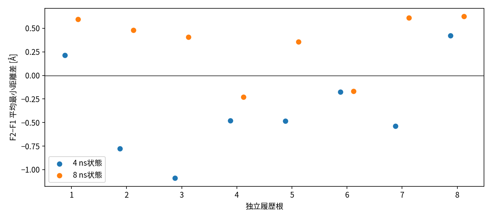
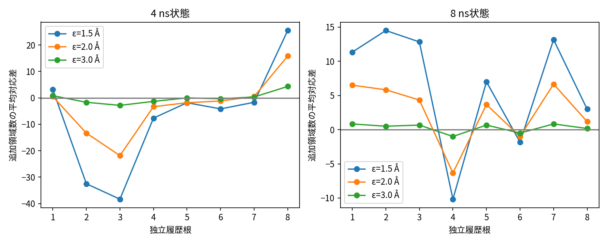

# P1-B1 Expansion：科学審査資料

報告日：2026-10-27。バッチ：`b1-expansion-20261026`。対象：1 GPU上のFSD-EY/OpenMM/CVAE。証拠の種類は実機の単一GPU測定と、その既存結果に対するderived analysisである。**科学計算COMPLETE、文書作成完了、保存・清掃を含む交付PARTIAL、独立科学審査と研究者受入れPENDING。** 18節は[登録済み交付要件](review-delivery-requirements.md)の番号に対応する。

## Executive Summary

新しいMDデータを含めるモデル更新が、旧データだけを同じ量だけ追加学習する場合に比べ、次のMD起点と下流4 nsの幾何探索をどう変えるかを検査した。8乱数履歴根の各4/8 nsから16状態を作り、F0凍結、F1旧のみ追加学習、F2旧新混合追加学習を比較した。F1/F2を同じ親weight/optimizer・200更新歩・800提示に揃えた。下流240本/960 nsと履歴64 nsを全て完了し、科学タスク失敗0、共有資源ゲートによる保護停止2回を保存した。

主幾何代理の全体F2−F1は**−0.0141 Å、探索的95%区間[−0.2092,+0.2105] Å、統計単位8根**。新データの一貫した優位も厳密な等価も支持しない。一方S4で−0.3636 Å、S8で+0.3355 Å、同根S8−S4は+0.6991 Åで8/8根が正だった。ただし候補数、履歴量、訓練窓、M0パラメータ、評価A0も変わるため、Xの因果効果やZ/Wを超えるCの予測力の証明ではない。

F2/F1のTop1は32/32比較で異なり、各臂15/16状態で学習seedでも起点が変わった。決定変更は下流改善とは異なる。全6離散設定を保管し、細かい尺度ではΔ21全体平均が負、3 Åでは小さい正へ変わる。全6区間は0を含む。追加学習wall平均4.2464 sは下流4 ns MDの209.5531 sより短く、B2の固定wall-clock純利益は未測定。

**保存上の残件**：サーバarchive9個/20,223,932,863 bytesは生成済み。Macの完全検証済archiveは0/9、転送はNEEDS_VPNで退出、未検証断片103,972,864 bytes。VPN復旧後も本輪の指示により再開せず、環境も清掃しない。[実測validation](../执行证据/2026-10-26-b1-expansion/validation.json)、[CPU再照合](../执行证据/2026-10-26-b1-expansion/report-review-statistics.json)、[保存状態](../执行证据/2026-10-26-b1-expansion/report-backup-status.json)。

## 1. 目的、背景、確認済みの境界

P1の目的は限られた計算時間でMDとAI更新をいつ実行すべきかを判断する根拠を作ることである。このB1は、まず同じMD量を実行した時の下流効果を測る。蛋白質の折り畳み機構、新CVAE、全HPC集群のschedulerは本輪の対象ではない。

既存DeepDriveMDの科学部品とmdlearnのCVAE（畳み込み変分オートエンコーダ）を使い、工程を既存Parsl適応層で記録する。学習と候補選択の実装を再利用することと、原論文の全科学設定・成果を再現することは異なる。本輪はnative RMSDを使わないLOF選択、少数歩の制御学習、明示した物理代理に限定する。[初期実装時の出典記録（歴史資料）](../../p1/server/science_sources.md)、[対象と以前の科学監査](../P1-S2/qualification-report.md)、[GQ/R2の否定的評価結果](../P1-GQ-R2/README.md)、[関連研究審査](../P1-RelatedWork/README.md)を背景として保持する。初期実装のRMSD順位や1 nm cutoffなどの歴史的記述を、現在のB1設定へ適用しない。現在の定義は凍結B1コードと本報告第5–8・16節による。これらの未完了資格を本輪の実行成功で置き換えない。

研究者CONFIRMEDは8根/16状態/240枝の実行、複数の解釈可能な代理による探索、C主線/B共同設計である。B2・正式C予測器・オンライン方策・S3はNOT APPROVED。本稿の解釈と次段階案はDERIVED/PROPOSEDであり、研究者の科学的結論ではない。

### 本文の用語

|用語|この実験での操作的意味|
|---|---|
|履歴根（root）|r01–r08。共通の準備構造から別乱数で生成した祖先履歴。頂点統計単位|
|決定状態（decision state）|同根の4/8 ns時点で公開済みデータ・モデル・候補・特徴を凍結した状態。蛋白質の準安定構造状態とは別|
|分枝（downstream branch）|選点座標から、固定条件/seedで4 nsを実行するMD。連続履歴の継続とは別|
|幾何領域（geometric region）|固定ε/τのgreedy規則が追加した代表。熱力学状態や生物学的発見数ではない|
|科学フィードバックX|決定前の新旧データ差・最近の探索/反復を表す固定特徴群。ZやWと独立と仮定しない|

## 2. Pilotからの変更と残った問題

Pilotは単一共通履歴状態、2対応乱数ブロックで、Δ21平均幾何差が−0.0478/+0.3588 Å、ε2 Å/τ5 psの領域差が−15/+3と不一致だった。単一状態で学習とMDの乱数が混ざり、Cの状態依存性を評価できなかった。[Pilot完全結果](../P1-B1-Pilot/paired-results.md)。

Expansionでは8別乱数履歴、同根S4/S8、学習2seed×MD3seedの交差を用いた。これにより状態内・状態間の変動を記述できるが、同一準備構造、2×3セルでの反復不足、時点束の交絡は残る。8根は「独立な初期構造8個」ではなく、同じ準備構造に条件付けた独立乱数系列である。

## 3. 事前固定と実際の実行

[事前計画](analysis-plan.md)のQ1は選点変更と学習乱数、Q2は下流差とMD変動、Q3は根/状態差と決定前状態の関係である。正のF2効果、有意差、折り畳み、唯一の状態数を成功要件としていない。結果を見て閾値や主条件を選ばない。

|版|実際の役割|
|---|---|
|060c72e981234a652deae7f3d8db2f4f2dfd4724|事前計画、行列、seed、指標、X/Z/Wの登録|
|40a911e1f36d1365fc5ee7d8753a7feb1edd964d|初回GPU前の新旧境界ID明確化を含む凍結科学ソース|
|344d59d995c2f9b99d6ced600440662ea3481edb|計算完了後の小型結果公開|
|a61792baf742bde8ce7fd03702644ff6ad929bb5|公開結果の保護取込・収集状態の記録|
|4771d2197af3e90609375ff3f8708cc2d3797395|今回の報告並行承認とCPU統計照合コード|

最初のGPU計算は10月26日18:19 JST、最後の枝評価は27日22:22:15、制御器終了は22:29:46。初回GPU前の累積浮動小数時刻境界の修正は物理窓・標本数を変えず、新旧の元区間/global IDを排他的にした。実行途中に有利な結果を見て枝/seed/順序を変更しない。全240行は[行列CSV](experiment-matrix.csv)、[JSON](experiment-matrix.json)、[乱数規則](randomization-plan.md)。完了順とソースSHAは[保存イベント](../执行证据/2026-10-26-b1-expansion/events.json)と[実行ソースSHA](../执行证据/2026-10-26-b1-expansion/executed-source-sha256.json)で追える。

## 4. 完了数と欠損

|項目|計画|成功|失敗/未実施|
|---|---:|---:|---|
|独立乱数履歴根 / 2 ns連続区間|8 / 32|8 / 32|0 / 0|
|S4/S8決定状態|16|16|0 / 0|
|M0 / 追加訓練|16 / 64|16 / 64|0 / 0|
|推論（F0再推論16を含む）|96|96|0 / 0|
|下流4 ns MD / 下流評価|240 / 240|240 / 240|0 / 0|
|科学task全体|1,024|1,024|0 / 0|
|履歴MD量 / 下流MD量|64 / 960 ns|64 / 960 ns|0 / 0 ns|

F0は48枝、F1/F2は各96枝。合計1,024 nsは分枝を含む総量で、1本の連続1.024 μs軌道ではない。下流1,920,000点は粗品質合格だが独立観測数ではない。[validation.json](../执行证据/2026-10-26-b1-expansion/validation.json)、[branch-status.csv](../执行证据/2026-10-26-b1-expansion/branch-status.csv)、[task-manifest.json](../执行证据/2026-10-26-b1-expansion/task-manifest.json)が全予定IDへの索引になる。保護停止2回は失敗科学task0と別計上する。

## 5. M0、F1、F2と全状態の再現条件

境界b=2,000/6,000 ps、決定t=4,000/8,000 ps。旧O800は(b−1900,b−400]、検証V200は(b−300,b]、新N400は(b,b+1600]。F0はM0を凍結、F1は旧800、F2は旧800の偶数位置400＋新400。**Δ21は400旧点を400新点へ置換するデータ組成の総効果**であり、新規性だけ、または全旧データを残した純粋追加の効果ではない。

M0は全16状態で未学習seed1600000001から旧800をbatch4×200歩。F1/F2も200歩/800提示、同じM0重み/optimizer、同Tの初期RNGと位置permutationを復元する。CVAEは28×28二値8 Å接触、filters16×4、kernel3×4、stride1/1/1/2、dense128、dropout0.5、latent3。RMSprop lr0.001、weight decay10⁻⁵、clip10、診断検証のみ、early stoppingなし。

全状態のID、親checkpoint、model/optimizer/RNG digest、学習seed、全step/提示量は [models.json](../执行证据/2026-10-26-b1-expansion/models.json) の80記録、CPU復元は [checkpoint-readback.json](../执行证据/2026-10-26-b1-expansion/checkpoint-readback.json) の80記録。実フレームID・提示順はraw recipe/exposureを[SHA索引](../执行证据/2026-10-26-b1-expansion/raw-artifact-sha256.json)で追う。[学習と全16状態表](model-training.md)に実seedを示す。loss低下は探索改善の証拠ではない。

## 6. 時間合法性、祖先、情報漏洩

根ごとの4区間は完全checkpointで連続する。S4のM0を0–2 nsの後・2–4 nsの生成前、S8のM0を4–6 nsの後・6–8 nsの生成前に構築した。S8はS4下流枝の結果を使わず、同未学習初期化から別M0を作る。この設計はオンラインでM0_4を継続更新したAI履歴ではない。

全16状態でM0_before_new_MD、state_freeze_sha_matches、features_before_branches=true、result SHA不一致0を最終監査した。X/Z/Wは未来枝より前に凍結。更新後順位・今回の追加学習実費・下流Yは入力特徴へ回填しない。[時間/SHA監査](../执行证据/2026-10-26-b1-expansion/temporal-and-SHA-audit.json)、[全履歴読戻し](../执行证据/2026-10-26-b1-expansion/all-histories-readback-01.json)、[系譜説明](data-lineage.md)。

候補に訓練フレームが重なるのは本オンライン選点設定の一部で、独立なモデル汎化試験ではない。検証200も同一履歴の時間splitであり、独立した生物学的試料ではない。

## 7. 候補選択と物理起点

状態ごと同じ候補pool/A0を全臂で共有する。S4は100<t≤4000 psの7,800点、S8は100<t≤8000 psの15,800点。CVAE predict batch64/seed2026102671、LOF20近傍、Minkowski p2、novelty=False、n_jobs2。negative score昇順、tieはglobal ID、Top1を採る。native参照は使わない。

|比較|Top1相違 / 比較数|起点dRMSD平均 [Å]（範囲）|角RMS平均 [度]|Top10 / Top100共通数の平均|
|---|---|---|---|---|
|F2-F1|32/32|3.7035 (1.3766–6.4094)|49.6380|0.3750 / 7.6875|
|F2-F0|31/32|3.3812 (0.0000–6.4094)|47.1590|0.2500 / 7.0625|
|F1-F0|29/32|2.5184 (0.0000–4.8908)|39.0602|1.0938 / 12.4688|

分母は16状態×2学習ブロック=32で、独立32根ではない。F0推論2回は全16状態で再現。F1/F2それぞれ15/16状態で学習seedを変えるとTop1が変わる。全240枝で選択座標と実MD投入座標は完全一致した。同一Top1・0距離がある比較も再選択せず保存した。[selection-comparisons.csv](../执行证据/2026-10-26-b1-expansion/selection-comparisons.csv)、[quality.json](../执行证据/2026-10-26-b1-expansion/quality.json)、[選択の詳細](candidate-selection.md)。候補変更・構造差・下流成果の優劣を同一視しない。

## 8. 物理代理の数学定義、単位、適用範囲

非周期の28Cα座標r_i[Å]、P3={(i,j):j−i≥3}の325対についてD_ij(x)=||r_i−r_j||、d(x,h)=sqrt[Σ_P3(D_ij(x)−D_ij(h))²/325] [Å]。状態の共通合格履歴A0を固定してm(x)=min_h∈A0 d(x,h)。主量Yは先頭100 psを除く下流4 nsのmのフレーム平均、補助に中央値/p90を保存。剛体移動・回転に不変だが鏡像を区別できず、履歴密度・伸展・短期緩和の影響を受ける。分割最近傍と小集合の厳密比較は240枝で誤差0 Å。

離散領域は2 ps抽出点を時系列順に処理し、固定A0と既追加代表からεより離れた新候補を、τの持続条件で確定する。ε=1.5/2/3 Å、τ=0/5 psの全6設定を固定。初点を無料で代表にしない。τ5は2 ps観測で最短6 ps。**greedyな幾何代表の追加数**であり準安定状態数・遷移率・生物学的発見数ではない。代表/確認時刻はraw discrete.jsonに保存する。

補助Rg=sqrt[Σ_i||r_i−mean_j r_j||²/28] [Å]（Cα等重み）、Q8=Σ_P4 I[D_ij<8 Å]/300（j−i≥4、無次元）、54主鎖角の周期最短差RMS[度]。角の最近傍はdに基づくA0最近傍。Rg/Qは形状の投影で、増加を一律に良いとしない。

全条件は[凍結契約](metric-contract.md)と[ソース](../../p1/server/expansion_analysis.py)。主表示4 ns/100 ps除外、感度burn0/200/500 psとprefix1/2/4 ns。条件の結果選択はない。[物理代理詳細](scientific-metrics.md)に領域アルゴリズム・時間相関・有効範囲を記す。

## 9. 完全な対応比較と陰性結果

D21_rt m=Y2_rt m−Y1_rt m。状態平均は6セル平均、根平均はS4/S8の平均、全体は8根平均。F0比較の同M共有を維持する。各量の方向と物理意味を区別し、異単位を合算しない。

|比較|根平均差 [Å]|探索的95%区間 [Å]|正/負の根数|
|---|---|---|---|
|F2-F1|-0.0141|[-0.2092, +0.2105]|3/5|
|F2-F0|-0.2036|[-0.4258, +0.0278]|2/6|
|F1-F0|-0.1895|[-0.4975, +0.0893]|3/5|

|ε [Å]|τ [ps]|比較|根平均差 [領域]|探索的95%区間|S4 / S8平均差|正/負の根|
|---|---|---|---|---|---|---|
|1.5|0.0|F2-F1|-2.1667|[-13.9583, +9.8339]|-14.8958 / +10.5625|4/4|
|1.5|5.0|F2-F1|-0.4792|[-6.5833, +5.8547]|-7.1875 / +6.2292|4/4|
|2.0|0.0|F2-F1|-0.6667|[-6.0836, +4.8648]|-5.2917 / +3.9583|4/4|
|2.0|5.0|F2-F1|-0.2396|[-3.8336, +3.4375]|-3.0833 / +2.6042|4/4|
|3.0|0.0|F2-F1|+0.1354|[-1.0315, +1.3646]|-0.3542 / +0.6250|4/4|
|3.0|5.0|F2-F1|+0.0938|[-0.6146, +0.8854]|-0.0833 / +0.2708|4/4|
|1.5|0.0|F2-F0|-10.5104|[-21.8859, +0.8438]|-31.9792 / +10.9583|2/6|
|1.5|5.0|F2-F0|-5.7396|[-12.0521, +0.8438]|-16.8542 / +5.3750|2/6|
|2.0|0.0|F2-F0|-4.3125|[-9.2604, +0.7086]|-12.4167 / +3.7917|2/6|
|2.0|5.0|F2-F0|-2.9271|[-6.5312, +0.8648]|-8.2708 / +2.4167|2/6|
|3.0|0.0|F2-F0|-0.8333|[-1.8854, +0.3440]|-2.4167 / +0.7500|2/5|
|3.0|5.0|F2-F0|-0.6146|[-1.3753, +0.1875]|-1.5417 / +0.3125|3/5|
|1.5|0.0|F1-F0|-8.3438|[-17.7500, +2.1982]|-17.0833 / +0.3958|2/6|
|1.5|5.0|F1-F0|-5.2604|[-10.3232, +0.3333]|-9.6667 / -0.8542|2/6|
|2.0|0.0|F1-F0|-3.6458|[-7.9375, +1.2083]|-7.1250 / -0.1667|2/6|
|2.0|5.0|F1-F0|-2.6875|[-5.5312, +0.3958]|-5.1875 / -0.1875|2/6|
|3.0|0.0|F1-F0|-0.9688|[-2.1042, +0.2917]|-2.0625 / +0.1250|2/6|
|3.0|5.0|F1-F0|-0.7083|[-1.5312, +0.1667]|-1.4583 / +0.0417|2/6|

細かいε1.5/2 ÅのΔ21全体は負、ε3 Åは正。全設定で区間0を含み、正/負根は4/4。主連続差の正/負根3/5とは完全には揃わない。全F0比較も含め[対応結果](paired-results.md)に連続18行/離散18行、全感度432要約を示す。[paired-effects.csv](../执行证据/2026-10-26-b1-expansion/paired-effects.csv)の41,472行、[continuous.csv](../执行证据/2026-10-26-b1-expansion/continuous.csv)の2,880行、[discrete-counts.csv](../执行证据/2026-10-26-b1-expansion/discrete-counts.csv)の17,280行に欠損はない。全感度条件を記録したことは全条件で同じ結論が保証されたことを意味しない。

## 10. 根級効果と同根の状態差

|根|S4 Δ21 [Å]|S8 Δ21 [Å]|根平均 [Å]|S8−S4 [Å]|
|---|---|---|---|---|
|r01|+0.2132|+0.5978|+0.4055|+0.3847|
|r02|-0.7784|+0.4809|-0.1487|+1.2593|
|r03|-1.0904|+0.4062|-0.3421|+1.4966|
|r04|-0.4786|-0.2299|-0.3542|+0.2488|
|r05|-0.4840|+0.3569|-0.0636|+0.8410|
|r06|-0.1761|-0.1679|-0.1720|+0.0082|
|r07|-0.5361|+0.6116|+0.0378|+1.1477|
|r08|+0.4216|+0.6279|+0.5247|+0.2063|

|比較|S4平均 [Å] (95%区間)|S8平均 [Å] (95%区間)|同根S8−S4 [Å] (95%区間)|時間差が正の根|
|---|---|---|---|---|
|F2-F1|-0.3636 [-0.6769, -0.0310]|+0.3355 [+0.0889, +0.5419]|+0.6991 [+0.3340, +1.0685]|8/8|
|F2-F0|-0.6170 [-1.1058, -0.0773]|+0.2098 [+0.0312, +0.3909]|+0.8268 [+0.1820, +1.4168]|6/8|
|F1-F0|-0.2534 [-0.6888, +0.1400]|-0.1256 [-0.3921, +0.1429]|+0.1278 [-0.2775, +0.4825]|6/8|

探索的区間は共通の根bootstrap10,000回/seed1604000001。S4とS8を切り離して16独立状態として再標本化しない。主Δ21の根SD0.3247 Å。r04/r06はS8も負、r01/r08はS4も正である。全8根の時間差が正でも、8根全てで更新が優位なのではない。全3比較の根別表は [report-main-root-effects.csv](../执行证据/2026-10-26-b1-expansion/report-main-root-effects.csv)、全量の根/時間差は [root-effects.csv](../执行证据/2026-10-26-b1-expansion/root-effects.csv) と [state-time-differences.csv](../执行证据/2026-10-26-b1-expansion/state-time-differences.csv)。

図1：1点は同状態6対応セルの平均Δ21[Å]、青S4・橙S8、各8根、下流4 ns/100 ps除外。エラーバーはなく、フレームや枝の独立性を表さない。横軸のずらしは可読性のため。図の各点はreport-review-statistics.jsonのfigure_pointsに列挙した。

## 11. 学習乱数とMD乱数の分解

学習T2−T1の行平均差、各行のMDseed SD、列平均、加法残差RMSを固定して保存した。例：r07-s4のΔ21行平均差+2.7646 Å、r01-s4は−1.6386 Å。小さな状態平均の背後に大きい内部変動があり得る。加法残差はe_tm=D_tm−D_t.−D_.m＋D_..、RMS=sqrt(mean e²)。

[乱数詳細](randomness-analysis.md)に全16状態の主Δ21、[randomness-decomposition.json](../执行证据/2026-10-26-b1-expansion/randomness-decomposition.json)に全9,216記録、[report-review-statistics.json](../执行证据/2026-10-26-b1-expansion/report-review-statistics.json)のmain_noise_rowsに主量64記録を保存。F0は状態3枝だけでT要因なし。1セル1軌道、学習seed2個では純粋な交互作用分散、精密な学習vsMD寄与率、根の純粋な物理異質性は同定できない。

## 12. 決定前X/Z/W、共通支持、Cの未成立部分

Xは非反復率、新→旧幾何距離、Rg/QのJS[bit]、最近セル増分[セル/ns]、最近反復率。Zは時点・MD量・候補数・訓練件数/歩数・Pilot費用等、Wは履歴被覆とRg/Q要約。式と時点内範囲は[状態診断](state-dependence-analysis.md)に記す。

|X（単位）|S4 範囲 / SD|S8 範囲 / SD|範囲の共通部分|ρ(X, Δ21) S4 / S8|
|---|---|---|---|---|
|new_nonrepeat_fraction_eps2|0.0375–0.9500 / 0.3643|0.0000–0.3975 / 0.1697|[0.0375, 0.3975]|-0.1905 / -0.1198|
|new_to_old_distance_mean_A|0.8640–3.0178 / 0.7451|0.7229–1.8922 / 0.4128|[0.864, 1.8922]|0.0238 / -0.0952|
|Rg_Q_JS_bits|0.1206–0.4657 / 0.1364|0.0492–0.2954 / 0.0973|[0.1206, 0.2954]|0.0476 / -0.8095|
|recent_grid_increment_per_ns|0.0000–3.0000 / 1.0155|0.0000–0.5000 / 0.1768|[0.0, 0.5]|-0.4059 / 0.2474|
|recent_repeat_fraction|0.8940–1.0000 / 0.0353|0.9960–1.0000 / 0.0014|[0.996, 1.0]|0.0120 / -0.2474|

S8のJS相関−0.8095だけを取り出して予測成功としない。XはWと情報を共有し、recent_repeat_fractionはX/Wで完全に同じフィールド。幾何距離XとYは表現を共有する。X範囲が部分的に重なってもZ候補数7,800/15,800には共通支持がなく、時点による履歴量・訓練窓・M0・評価A0の変化が残る。S8の大きいA0は評価尺度そのものを変える。Z/W条件付きのX増分予測も、Xの因果性も未検証。

Z.model_data_age_ns=2はt−bで、最新訓練フレーム年齢ではない。[名称訂正](implementation-errata.md)を保持する。全8根は探索開発に使用済みで、今後同根を隠したかのような最終検証に再利用しない。残wall-clock horizonはnull、B1では固定MD量のためである。[features.json](../执行证据/2026-10-26-b1-expansion/features.json)、[state-diagnostics.csv](../执行证据/2026-10-26-b1-expansion/state-diagnostics.csv)。

## 13. 計算環境、実費、失敗と保存

GPUは1×RTX PRO6000 Blackwell Max-Q96GB（報告97887 MiB）、driver590.48.01。Python3.12.3/Torch2.7.1+cu128/OpenMM8.5.2・CUDA12plugin/NumPy1.26.4/MDAnalysis2.9.0/sklearn1.6.1/Parsl2025.10.20/mdlearn0.0.10a1（938cb80）。[環境](../执行证据/2026-10-26-b1-expansion/environment.json)、[依存lock](../执行证据/2026-10-26-b1-expansion/requirements.lock.txt)。

GPUプロセス占有54,422.929387 s、タスクwall合計61,071.645465 s。下流4 ns MD平均209.5531 s、追加学習4.2464 s、推論4.2532 s。GPU診断は1秒程度の標本でkernel積算時間ではない。[費用全分類・CPU・入れ子計時](cost-and-runtime.md)、[costs.json](../执行证据/2026-10-26-b1-expansion/costs.json)、[GPU-diagnostics.csv](../执行证据/2026-10-26-b1-expansion/GPU-diagnostics.csv)に基づく。共有履歴や内部fitを二重加算しない。

科学タスク失敗0、CPU/メモリゲート停止2回、同条件SHA照合後に旧成功taskを再実行せず復元。原因は複合ゲートの例外のみでCPU/メモリのどちらか、特定他者の作業かはUNVERIFIED。取込時に2旧ログと脱敏版が衝突し、旧ファイルを残して別名保存した。[失敗記録](failures-and-amendments.md)は不利な科学結果と工程故障を分ける。

サーバ9archive/20,223,932,863 bytes、圧縮419.346117 s。Mac完全検証0/9、未検証断片103,972,864 bytes、転送退出、今回再開なし。原データ・重み・全ログは許可保管先のみ、GitHubには小型表とraw SHA索引を保存。双端検証前の清掃なし。報告が存在することを完全再現配布の資格としない。

## 14. 正面・陰性・不一致・未確定の所見

|観測|支持される読み方|支持されない読み方|
|---|---|---|
|全16状態で参照なし推論が動き、実MD入力が一致|工程と選点の追跡が可能|生物学的に良い起点を選べた|
|F2−F1 Top1相違32/32、起点距離平均3.7035 Å|データ組成で決定と幾何が変わる|変化が全て新規性の効果、必ず探索改善|
|全体Δ21約−0.0141 Å、区間は両側|この設定の全体優位は未確認|厳密に無効果/等価|
|S8−S4は8/8正|状態束による効果差を追加検討する根拠|科学状態Xが原因、C予測器が成立|
|ε3 Åで全体符号が反転|尺度により問い・計数が変わる|有利なεだけ正式採用|
|学習seed/MDseedの変動が大きい状態|単一seedの結論は不安定|純粋な各分散成分を識別済み|
|更新wall約4秒|実配置では更新が短い|B2純利益は必ず正、競争を人工的に増やすべき|

図2：ε1.5/2/3 Å、**τ=5 psのみ**、2時点×8根=48点。縦軸は追加領域差、下流4 ns/100 ps除外。τ0の結果は第9節の表と原CSVを併読する。線は名目的な根IDを結ぶだけで、時間推移ではない。尺度ごとの縦軸範囲や点を見て一設定に絞らない。第12節の[診断図](state-dependence-analysis.md)を含む既存3図はソースと80描画点の索引を照合し目視確認した。未加工PNGのSHAは[図表監査](figure-and-table-audit.md)に記す。

## 15. 事前の問いに対する支持範囲

|問い|実行端の評価|根拠と限界|
|---|---|---|
|Q1 更新で選点が変わるか・seed依存か|限定条件で支持（DERIVED）|Top1物理差と15/16seed変化。参照なし工程は動くが選点の最適性は未確認|
|Q2 等MD量で新旧混合が一貫して良いか|INCONCLUSIVE|全体区間は広く、根・尺度・時点で不一致。明確なF2勝利はない|
|Q3 状態束に効果差があり今後検証すべき関係か|探索的所見あり|8/8時間差は正だが時点交絡と内部乱数が残る|
|C：XがZ/Wを超える情報を持つか|UNVERIFIED|条件付き/独立rootの予測評価なし、特徴重複と支持の不足|
|B2：固定wall-clockで更新が得か|UNVERIFIED|等MD量設計、horizon/機会費用の実対照なし|
|折り畳み・準安定状態・汎用科学価値|対象外/未認定|幾何代理と短期軌道だけでは結論不能|

上表は研究者受入れではない。科学的な支持を工程PASSから導かない。

## 16. 妥当性への脅威と科学資格

初期入力はDeepDriveMD由来unfolded PDB、SHA8cb0382cb19e24c1159eb672b236bc1a6642fc8025e6c5cb8200c3c4c435d2b3、504原子/28残基。Amber14-all/GBn2/NoCutoff、非周期、300 K、Langevin1 ps⁻¹、2 fs、HBonds tol10⁻⁵、mixed CUDA/DeterministicForces。履歴開始のみ最小化（10 kJ/(mol nm)、最大1000反復）と速度生成。履歴間はcheckpoint継続、下流枝は選択座標の再最小化/速度reseedである。下流をそのまま連続平衡軌道や自然な遷移確率としない。

有限座標/54角、拘束残差≤0.01 Å、隣接Cα2.5–5 Å、ペプチドC–N0.8–2 Å、非隣接重原子≥0.8 Å、側鎖手性を検査。全下流点の粗合格はpH・プロトン化・初期構造作成史・十分な平衡を認証しない。NoCutoffは承認探索条件であり万能な正式科学protocolの認定ではない。先頭100 psを除いても緩和biasが消えたとは確認していない。[品質](data-quality.md)。

相関例：最初の下流枝Rg自己相関はlag0.5 psで0.9544、10 psで0.6751。1,920,000点を独立標本としてCIを狭めない。全枝の[自己相関診断](../执行证据/2026-10-26-b1-expansion/autocorrelation.json)は非定常有限系列の記述であり、積分相関時間や有効独立数を認定していない。

他の制約は、同一準備構造/蛋白質/力場/GPU、8根小標本、多指標、2学習seed、同初期化の制御M0、少数学習量、候補/A0の時点差、X/Y表現共有、Wとの重複、共有ハードウェア/時段差である。訓練seedや指標を増やすだけで全てが解消するわけではない。外挿はこの短時間局所探索に限る。[統計上の限界](statistical-limitations.md)。

## 17. B2/Cへ進む条件と再現手順

工程上の等MD量比較を再現できる部品は存在する。次に必要なのは、時点束の差をどの問いとして検証するか、物理資格/学習配方をどう認めるか、X/Z/Wの重複と独立root検証をどう扱うかの審査である。現状の約4秒更新に基づいて固定予算比較の検証可能性も考える必要があり、B2/Cの科学資格が揃ったとは判定しない。

既存結果のみを再照合する手順：固定commitと依存lockを取得→許可保管先の公開表/索引SHAを確認→GPU不可視・単一CPUで[CPU照合コード](../../p1/report_review_audit.py)にinput-dirと新output-dirを渡す→stdoutとreview-statistics.jsonを元CSV/JSONへ照合する。GPUMD/モデル推論は呼ばない。実行コード4771d21のSHAを結果に収録した。raw追跡はraw-artifact-sha256.json→task相対パス→根archive/metadataのSHA索引で行う。詳細は[再現手順](reproduce.md)。原データ復元には既存GQ/R2資産も必要で、コードcloneだけでstandalone再現できるとは主張しない。

計算COMPLETE、時間/SHA監査passed、CPU表整合passed。バックアップ/清掃/独立審査/研究者受入れは別ゲートで未完了。S2独立終審もINCOMPLETEのまま。S3を承認する根拠を本輪で代替しない。

## 18. 研究者に委ねる判断と停止

[次段階の比較案](next-stage-recommendation.md)のA（状態束の識別）、B（物理/学習配方資格）、C（独立rootでのC/B2確認設計）は全てPROPOSED。まず計画側が本稿と原表を独立審査し、どの推定対象・評価基準・許容交絡を次に固定するか決めることを提案する。保存再開についても別途明示判断を待つ。

本輪で科学条件を変更せず、MD/学習/GPU推論0、アーカイブ転送再開0。文書と既存統計CPU照合を終了して停止する。B2、C正式予測、オンライン方策、S3は自動開始しない。最終同期版と全索引は[ChatGPT引継ぎ](handoff-to-chatgpt.md)、本文/リンク/図表監査は[交付監査](delivery-audit.md)を参照する。
