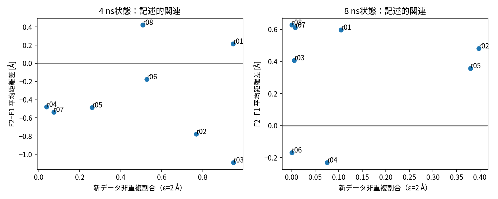

# 状態差と科学フィードバックXの探索的診断

2026-10-27、DERIVED。正式C予測器は学習していない。Cの問いは「Xが費用・データ量・訓練状態Zと履歴記述Wを超えて更新価値に情報を加えるか」であり、時点間の平均差だけでは答えられない。

## 観測した状態差

|比較|S4平均 [Å] (95%区間)|S8平均 [Å] (95%区間)|同根S8−S4 [Å] (95%区間)|時間差が正の根|
|---|---|---|---|---|
|F2-F1|-0.3636 [-0.6769, -0.0310]|+0.3355 [+0.0889, +0.5419]|+0.6991 [+0.3340, +1.0685]|8/8|
|F2-F0|-0.6170 [-1.1058, -0.0773]|+0.2098 [+0.0312, +0.3909]|+0.8268 [+0.1820, +1.4168]|6/8|
|F1-F0|-0.2534 [-0.6888, +0.1400]|-0.1256 [-0.3921, +0.1429]|+0.1278 [-0.2775, +0.4825]|6/8|

|根|S4 Δ21 [Å]|S8 Δ21 [Å]|根平均 [Å]|S8−S4 [Å]|
|---|---|---|---|---|
|r01|+0.2132|+0.5978|+0.4055|+0.3847|
|r02|-0.7784|+0.4809|-0.1487|+1.2593|
|r03|-1.0904|+0.4062|-0.3421|+1.4966|
|r04|-0.4786|-0.2299|-0.3542|+0.2488|
|r05|-0.4840|+0.3569|-0.0636|+0.8410|
|r06|-0.1761|-0.1679|-0.1720|+0.0082|
|r07|-0.5361|+0.6116|+0.0378|+1.1477|
|r08|+0.4216|+0.6279|+0.5247|+0.2063|

Δ21のS8−S4が8根とも正であることは、この設定の状態束により平均差が変わる探索的所見である。S8のr04/r06ではΔ21自体は負で、S4のr01/r08では正。単純な「4 nsなら更新しない、8 nsなら更新する」方策の検証ではない。区間は8根のpercentile再標本化で、多重比較・小標本・8根を既に観察したことによる制約がある。

## Xの定義

旧集合O800、新集合N400について、dは325対Cα距離のdRMSD[Å]。

- 非反復率 x1=mean_N I[min_O d(x,o)>2 Å＋10⁻¹⁰ Å]（無次元）。補助に新→旧最小距離の平均[Å]を記録する。
- 分布差 x2=JS(p_N,p_O)=[KL(p_N||m)+KL(p_O||m)]/2 [bit]、m=(p_N+p_O)/2。Rg0.5 Å×Q8 0.05の固定セル、log2、0log0=0、平滑化なし、原点0、clipなし。
- 最近増分 x3=[U_grid(H_t)−U_grid(H_b)]/2 ns [セル/ns]。b=t−2 ns、Hは100 ps以後2 ps抽出の合格履歴。
- 最近反復率 x4：最近(b,t]の抽出点のうちH_bの既訪問セルに入る比率（無次元）。

x1は400/800の容量に依存し、x2は低次元投影の混同を残す。x3/x4はWの被覆・反復記述と重なる。全16入力は [features.json](../执行证据/2026-10-26-b1-expansion/features.json)、全時刻内変動は [feature-variation.csv](../执行证据/2026-10-26-b1-expansion/feature-variation.csv)。

## 同時刻8根内の記述

|X（単位）|S4 範囲 / SD|S8 範囲 / SD|範囲の共通部分|ρ(X, Δ21) S4 / S8|
|---|---|---|---|---|
|new_nonrepeat_fraction_eps2|0.0375–0.9500 / 0.3643|0.0000–0.3975 / 0.1697|[0.0375, 0.3975]|-0.1905 / -0.1198|
|new_to_old_distance_mean_A|0.8640–3.0178 / 0.7451|0.7229–1.8922 / 0.4128|[0.864, 1.8922]|0.0238 / -0.0952|
|Rg_Q_JS_bits|0.1206–0.4657 / 0.1364|0.0492–0.2954 / 0.0973|[0.1206, 0.2954]|0.0476 / -0.8095|
|recent_grid_increment_per_ns|0.0000–3.0000 / 1.0155|0.0000–0.5000 / 0.1768|[0.0, 0.5]|-0.4059 / 0.2474|
|recent_repeat_fraction|0.8940–1.0000 / 0.0353|0.9960–1.0000 / 0.0014|[0.996, 1.0]|0.0120 / -0.2474|

相関対象は主幾何Δ21、各時刻n=8。全5特徴×全12主代理×2時刻の診断は [state-diagnostics.csv](../执行证据/2026-10-26-b1-expansion/state-diagnostics.csv) にある。大きい例としてJSのS8 ρ=−0.8095があるがS4は+0.0476で、選択した一つの相関からC成立を宣言できない。非反復率は両時刻とも弱い負、最近増分と反復率は時刻により符号が変わる。ρは不確実性の小さい予測性能推定ではなく、因果係数でもない。

XとW.grid_cells_totalの全相関も同表に保存する。recent_repeat_fractionはXとWで**同一値の重複フィールド**であり、独立情報と扱えない。x1/距離と下流Yは同じ距離表現を使うため、幾何学的な機械的関連や履歴参照の影響がある。

## 共通支持と識別不能部分

Xの一変量範囲は部分的に重なる。非反復率の共通範囲[0.0375,0.3975]内に入るのはS4の3/8、S8の4/8状態である。範囲の重なりは同じX/Z/W条件で比較可能という保証ではない。Zの候補数はS4=7,800、S8=15,800で重なりがなく、累積MD量・旧訓練窓・M0最終パラメータ・評価A0も変化する。Xだけの効果を時点差から分離できない。

S8のA0はより大きい。min距離は参照点の追加だけでも小さくなり得るため、時間差には**評価基準の変更**も含まれる。同時刻内ではA0共通で比較は揃っているが、時点間の差の差を純粋な物理状態効果としない。残wall-clockは未設定、費用推定は事前Pilot値、更新後の実費・順位・未来YはX/Z/Wへ入れていない。

Z.model_data_age_ns=2は最新訓練フレームの年齢ではなくt−b。原値を残して[訂正](implementation-errata.md)を参照する。M0をS8でも同じ未学習初期化から作る設計はオンライン継続学習そのものではない。

全8根は開発・探索で既に観測済み。条件付き増分予測、独立rootでの汎化、費用を含む方策価値はいずれもUNVERIFIED。Cの証明に必要な設計を研究者と計画側が審査する段階であり、Cを棄却済みとも採択済みとも扱わない。

図：各panel8根、4 ns下流/100 ps除外、縦軸Δ21[Å]。panelの縦軸範囲が異なるので図上の高さを時点間で直接比較しない。回帰や予測器は含まない。点の出典はstate-effects.csvとfeatures.json。注釈は根番号であり独立な16根を意味しない。

## XとWの数値関係

次は同時刻8根でのρ(X, W.grid_cells_total)。X–効果相関と異なる列で、条件付き残差効果ではない。

|X|S4 ρ|S8 ρ|
|---|---:|---:|
|new_nonrepeat_fraction_eps2|0.0000|-0.1867|
|new_to_old_distance_mean_A|-0.1429|-0.1557|
|Rg_Q_JS_bits|0.2619|-0.0120|
|recent_grid_increment_per_ns|0.5581|-0.4149|
|recent_repeat_fraction|-0.4311|0.4149|
