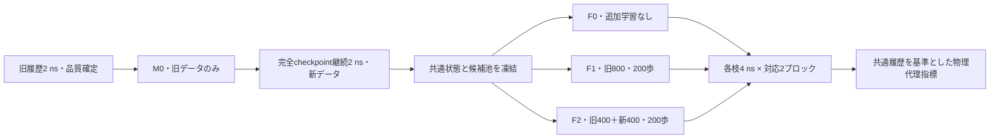

# 実験設計：同一MD量の対応三臂

本輪は1つの実際に生成した共通状態に対する探索的な決定効果の診断である。旧GQの「唯一の指標の認証」を入口条件にせず、研究者が承認した複数の事前固定物理代理指標を全て報告する。物理条件の未確認事項が解決したと宣言する変更ではない。

M0のweightとoptimizerを各更新の共通初値とし、同じブロック内のF1/F2は同じ初期RNG、同じ800位置のpermutationを使う。各点を1回ずつ曝光するため、旧400を二度使ってF1を800にする旧S2補充の配方とは異なる。候補池・推論seed・LOF・tie-breakは全モデル共通。

学習seedは2026102681/82、MDseedは2026102691/92。同ブロック内は共通MDseedだが、異なる出発点で同一の力学軌跡や乱数効果が保証されるわけではない。下流順はF0→F1→F2、次ブロックはF2→F1→F0。初期化・温度/キャッシュ/時段への系統的偏りを軽減する固定逆順であり、完全な無作為化や交差分散分解ではない。

Yを固定4 ns後の代理量とし、各指標別にΔ21=Y2−Y1、Δ20=Y2−Y0、Δ10=Y1−Y0を算出する。Δ21はデータ組成変更の総効果であり、純粋な新規情報の効果ではない。学習時間を差し引かないため、固定壁時計下での資源配分の純利益は推定しない。

実験範囲：共通歴史4 ns、下流6×4 ns=24 ns、1共通状態のみ。適切な陰性結果・逆効果・尺度間不一致を許容する。次の独立状態やC予測器、B2を自動生成しない。
