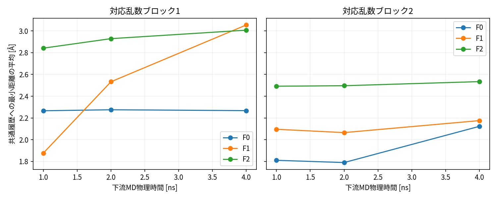
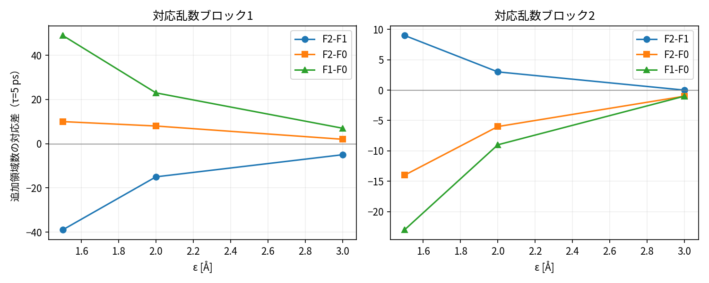
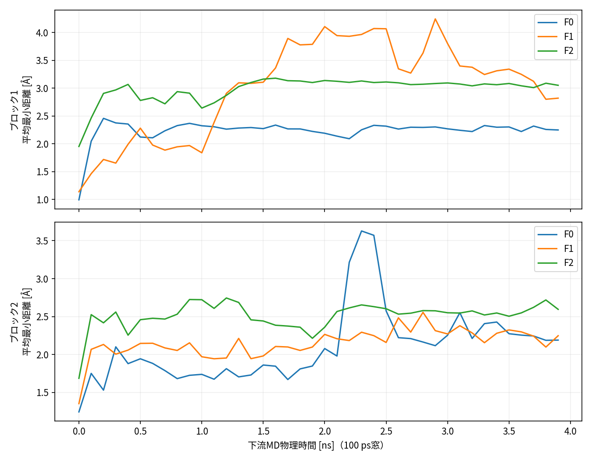

# 対応結果と解釈

2026-10-26、全てサーバ実測/派生。1共通状態・二対応乱数ブロックの探索的結果。下流各4 ns、主解析100 ps除外（各7,800点）。数値は表示丸めで、完全精度は証拠JSON/CSVに保持した。

## 連続幾何代理：共通履歴への最小距離

| ブロック | 条件 | 平均 Å | 中央値 Å | p90 Å |
|---:|---|---:|---:|---:|
| 1 | F0 | 2.2670 | 2.2806 | 2.4178 |
| 1 | F1 | 3.0553 | 3.2220 | 4.0442 |
| 1 | F2 | 3.0075 | 3.0605 | 3.1918 |
| 2 | F0 | 2.1225 | 2.0538 | 2.6663 |
| 2 | F1 | 2.1753 | 2.1701 | 2.4373 |
| 2 | F2 | 2.5342 | 2.5406 | 2.7699 |

| 対応差 | ブロック1 平均/中央値/p90 Å | ブロック2 平均/中央値/p90 Å |
|---|---|---|
| F2−F1 | −0.0478 / −0.1614 / −0.8524 | +0.3588 / +0.3705 / +0.3326 |
| F2−F0 | +0.7405 / +0.7799 / +0.7740 | +0.4117 / +0.4868 / +0.1035 |
| F1−F0 | +0.7883 / +0.9413 / +1.6264 | +0.0529 / +0.1163 / −0.2290 |

F2はF0より平均最小距離が両ブロックで大きい。一方F2−F1は符号不一致で、新データ追加に固有の安定した改善を支持しない。F1もF0から変わるため「更新あり対なし」の差だけを新データの効用に帰属できない。

## 全6尺度の離散領域代理

括弧内はF0/F1/F2の追加数。最後はF2−F1、F2−F0、F1−F0の順。

| ブロック | ε Å | τ ps | F0 / F1 / F2 | 三つの対応差 |
|---:|---:|---:|---|---|
| 1 | 1.5 | 0 | 15 / 113 / 34 | −79 / +19 / +98 |
| 1 | 1.5 | 5 | 8 / 57 / 18 | −39 / +10 / +49 |
| 1 | 2 | 0 | 6 / 46 / 12 | −34 / +6 / +40 |
| 1 | 2 | 5 | 2 / 25 / 10 | −15 / +8 / +23 |
| 1 | 3 | 0 | 1 / 10 / 2 | −8 / +1 / +9 |
| 1 | 3 | 5 | 0 / 7 / 2 | −5 / +2 / +7 |
| 2 | 1.5 | 0 | 73 / 37 / 49 | +12 / −24 / −36 |
| 2 | 1.5 | 5 | 39 / 16 / 25 | +9 / −14 / −23 |
| 2 | 2 | 0 | 27 / 13 / 16 | +3 / −11 / −14 |
| 2 | 2 | 5 | 16 / 7 / 10 | +3 / −6 / −9 |
| 2 | 3 | 0 | 2 / 0 / 2 | +2 / 0 / −2 |
| 2 | 3 | 5 | 1 / 0 / 0 | 0 / −1 / −1 |

F2−F1は第1ブロックで全尺度負、第2では正または0。F2−F0は第1で正だが第2で負または0である。連続距離と領域数も一致しない。履歴から遠い少数領域に長く居ることと、広く多数の領域を訪れることは異なる操作量であり、一方を都合よく削除しない。

## 時間・緩和感度

100 ps除外のF2−F1平均距離は、ブロック1でprefix1/2/4 nsが+0.9657/+0.3966/−0.0478 Å、ブロック2で+0.3963/+0.4314/+0.3588 Å。第1の4 nsだけを示して早い区間の違いを隠さず、逆に1 nsだけで勝利を宣言しない。

4 nsの除外0/100/200/500 psで第1の平均差は−0.0263/−0.0478/−0.0753/−0.1840 Å、第2は+0.3582/+0.3588/+0.3563/+0.3571 Å。登録した除外候補だけでは符号不一致は消えない。これらは同じ軌跡の記述で、独立反復や固定wall-clock実験ではない。

## 構造・品質と結論

全6枝48,000フレームが登録済みの粗い幾何条件を通過した。全枝で実際のMD投入座標は選点DCDと一致。平均温度299.897–300.411 K。これを準備/pH/平衡化の科学認証としない。

補助Rg平均はブロック1のF0/F1/F2が7.796/8.677/8.771 Å、ブロック2は8.349/8.429/8.859 Å。Q8と主鎖角も全表に残す。コンパクトさを成果の優劣に変換していない。

**DERIVED判定：選点差と下流の幾何差は観測されたが、F2の安定した上乗せ改善はINCONCLUSIVE。** 二つのブロックが同じ科学状態に属する以上、この符号差を科学フィードバック状態による異質効果の証拠にしてはいけない。

[連続全表](../执行证据/2026-10-26-b1-pilot/continuous.csv)、[離散全表](../执行证据/2026-10-26-b1-pilot/discrete-counts.csv)、[864対応差](../执行证据/2026-10-26-b1-pilot/paired-results.csv)、[品質](../执行证据/2026-10-26-b1-pilot/quality.json)。
