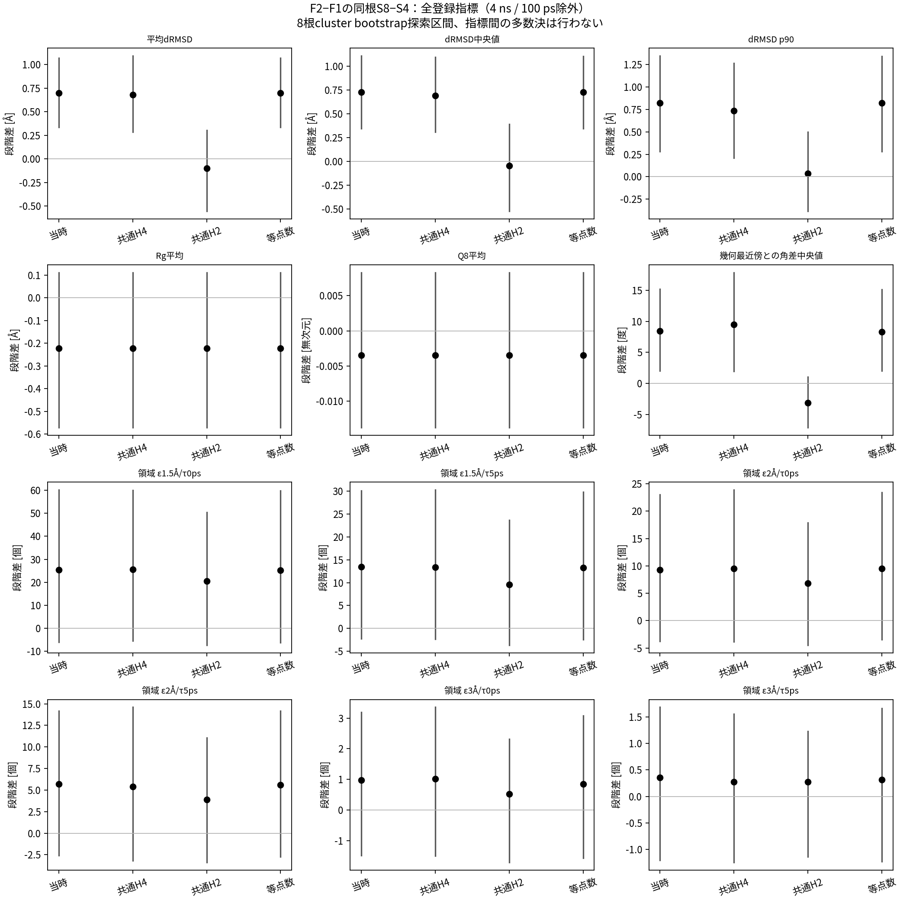
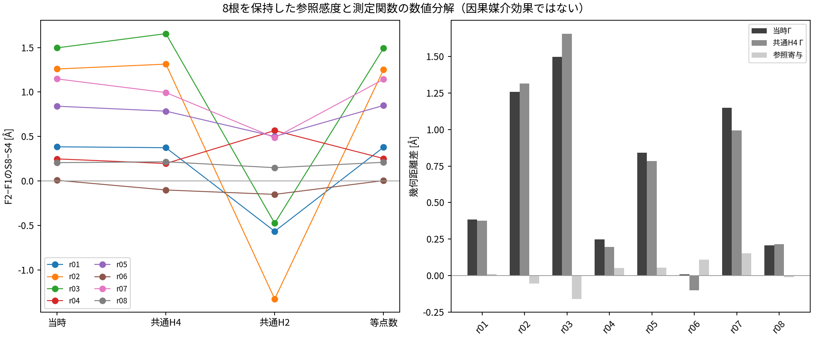

# P1-B1-R1：評価参照と段階差のCPU科学復核

2026-10-28 JST。**承認済みCPU再解析と結果監査は完了。独立科学審査・研究者の科学的受入れはPENDING。** 最終GitHub同期は、実在する最終commitと遠隔回読で確認する。本輪を閉じ、次の科学計算は開始しない。

**GITHUB_EVIDENCE_DELIVERY：PASS。** 結果交付commit `a7d0b3d5a21276f35b7ea45eb5a2d133656db2be` を独立した空Git領域へGitHubから取得し、97本文/77,320,235 bytesのSHA-256と大きさを全照合した。[遠隔回読証跡](github-remote-readback.json)を参照。後段の検証記録commitを含む最終SHAはGit履歴と最終返信で示す。独立科学審査・研究者受入れはPENDINGのままである。

## 審査の入口

1. [完全科学報告](review-dossier.md)：数学定義、全参照・全尺度、8根の結果、乱数、費用、限界。
2. [ChatGPTへのA–G引継ぎ](handoff-to-chatgpt.md)：確認状態、主結果、技術情報、未解決事項、索引、次の判断。
3. [統合的な読取り](interpretation-and-review.md)：共通H4とH2の不一致、陰性結果、事前判定表との対応。
4. [最終進捗](execution-progress.md)、[再現手順](reproduce.md)、[交付静的検証](delivery-validation.json)、[後処理・保持記録](cleanup-verification.json)。

## 結果の要点と限界

DERIVED。事前指定の下流4 ns・先頭100 ps除外について、Δ21をF2−F1、Γを同根S8−S4の差とする。独立統計単位は8歴史根であり、保存フレームや960論理条件ではない。

|平均幾何距離の段階差 Γ [Å]|8根平均|探索的95%区間|
|---|---:|---|
|ORIGINAL_HISTORY|+0.699065|[+0.333987, +1.068522]|
|COMMON_A4|+0.679662|[+0.284963, +1.090307]|
|COMMON_A2|−0.101443|[−0.553137, +0.302143]|
|MATCHED_COUNT|+0.698041|[+0.335141, +1.067481]|

共通H4では7/8根で正だったが、共通H2と一致しない。全6離散尺度の段階差の区間は0を含む。共通H4のS4/S8を平均したF2−F1全体効果も−0.023775 [−0.216596, +0.199295] Åであり、更新の一般的優位は確認していない。参照寄与は主平均で+0.019403 [−0.047509, +0.080121] Åだが、等価性や「参照の影響は無視できる」を認定する値ではない。

評価A0の変更だけでは共通H4の差を説明しきれない一方、候補集合・M0・訓練窓・起点の交絡は残る。XのZ/Wを超える価値、B2固定wall-clock純利益、物理P・学習L資格は未確認。未実行の新Top1の下流はNOT_OBSERVEDのままである。

## 全表と小型閲覧表

小型表は事前指定の100 ps除外・4 ns行の転記で、数値の再推定や有利な尺度の選別をしていない。[view監査](compact-view-audit.json)に元表/転記表SHAと列・行数を記録する。

|内容|小型表|全12時間条件の完全表|
|---|---|---|
|全参照・全比較・全尺度の8根要約|[576行](main-root-summary.csv)|[6,912行](root-summary.csv)|
|根別S4/S8・段階差|[1,152行](main-root-stage-effects.csv)|[13,824行](root-stage-effects.csv)|
|評価参照変更の恒等分解|[288行](main-reference-decomposition.csv)|[3,456行](reference-decomposition.csv)、[要約](reference-decomposition-summary.csv)|
|六連続量の枝単位評価|[960行](main-continuous.csv)|[11,520行](continuous.csv)|
|六離散尺度の枝単位評価|[5,760行](main-discrete-counts.csv)|[69,120行](discrete-counts.csv)|
|学習/MD乱数階層|[主量64行](main-randomness-diagnostic.csv)|[全36,864記録](randomness-decomposition.json)|

[全165,888配対差](paired-effects.csv)、[状態27,648行](state-effects.csv)、[全尺度段階差](all-scale-stage-differences.csv)、[時間窓](time-windows.csv)、[時間相関](autocorrelation.csv)、[Top1出所](selected-origins.csv)、[FULL再現](LOF-full-reproduction.csv)、[候補制限診断](pool-selection-diagnostic.csv)、[選点と観測済み効果の連結](selection-effect-links.csv)も保管する。

## 図

[図表の読取りと監査](figure-and-table-audit.md)を参照。全6連続量・全6離散条件を示し、都合のよい尺度だけを選ばない。

## 完全性・費用・科学範囲

MEASURED：15,208原ファイルと9原archiveのSHAを開始/終了時に照合。240/240枝の元評価を再現し、連続17,280値・フレーム最小距離の最大絶対誤差0、ID/整数は完全一致。全参照は960論理条件＝720実評価＋240同一参照alias、欠測0。LOFは保存embeddingの160 fitで、CVAE再推論ではない。科学段階wall合計6,999.449662 s、CPU合計6,996.298536 s、ピークRSS307.621 MiB。報告生成・配備・待機は別計数とする。

[結果監査](result-audit.json)、[原再現の実誤差](original-reproduction-accuracy.json)、[最終不変監査](final-integrity.json)、[費用](delivery-costs.json)、[LOF監査](LOF-audit.json)、[環境](environment.json)、[実行manifest](execution-manifest.json)、[失敗と復旧](delivery-notes.md)、[最新公開SHA索引](public-evidence-index.json)を照合する。server-v1索引は編集前の歴史snapshotであり、現在のSHA索引ではない。

GPU・MD・CVAE学習・モデル推論は0。原DCD/重み/原ログと9archiveはサーバに保持し、Mac raw backupはWAIVED_BY_RESEARCHER。B2・C予測器・S3は禁止。次は研究者とChatGPTの独立審査のみ。

## 承認設計と履歴

承認設計commitは`59f97821ae6ffe283c371f710546abf84f691642`。[analysis-plan](analysis-plan.md)、[script-design](script-design.md)、[decision-criteria](decision-criteria.md)、[cost-and-scope](cost-and-scope.md)、[data-index](data-index.md)、[未識別交絡](unidentified-confounders.md)は設計時の文面を保持する。その「未実行」は履歴で、現状は本入口と最終進捗に従う。[設計時README](design-README-59f97821.md)と[設計時引継ぎ](design-handoff-to-chatgpt-59f97821.md)も別名で保持した。
