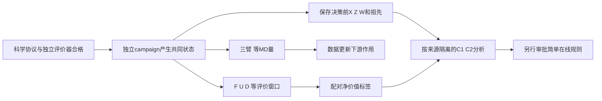

# 联合实验方案：共享分支、分开估计

2026-10-25｜全部 PROPOSED，未运行、未批准参数。依赖[评价资格](evaluation-and-statistics.md)与[审批卡](experiment-approval-proposal.md)。

## 1. 生成共同状态，而非从胜负中挑状态

独立 campaign i 从经审查的准备结构与独立随机流开始，按固定采集政策产生历史。在预先规定的第 j 个已完成 MD/数据里程碑保存快照，不能按“这时更新效果特别好”选点。早/中状态是采集规则，不能直接当科学状态标签。对于不同 i，在同 j、同历史训练步骤、同训练集容量和相同 h 下比较不同 X。

每个分支需要保存：原子顺序/拓扑、原始坐标及其准备史、已合格候选池 P_t、D_old/D_new、模型及优化器、预处理版本、RNG、U_initial、资源及软件清单、时间可用性和完整祖先图。历史训练不是免费的：作为相同前置成本单列；评价“从此状态开始的剩余预算”与“从零开始的总工作流成本”分别报告。

祖先共享的所有状态、分支、训练seed、horizon进入同一个数据 split。通用初始模型只能由事前独立校准数据训练并冻结；不得使用最终验证根的数据训练共同 checkpoint。当前S2 checkpoint用于开发演练，不冒充未见验证初值。

## 2. B1 配对三臂

| 项目 | F0冻结 | F1-old | F2-new |
|---|---|---|---|
| 初始模型与优化器 | 同一哈希 | 同一哈希恢复 | 同一哈希恢复 |
| 学习输入 | 无更新 | N个旧帧组成固定容量集 | 等容量，预声明比例用新帧替换旧帧 |
| 优化 | 0步 | K步、batch b、Kb曝光 | 相同K、b、Kb曝光 |
| 第一次推理 | 同一P_t、新鲜推理 | 同一P_t | 同一P_t |
| 选择规则 | 相同无native参考规则、相同tie-break和推理seed | 同左 | 同左 |
| 后续科学计算 | 相同k段×L ns、相同重播种/资格规则 | 同左 | 同左 |
| 结果 | Y₀(q)、选择/成本诊断 | Y₁(q) | Y₂(q) |

F2新帧比例候选为1/2，**不是已确定参数**；N、K、b、比例由独立资格数据和科学审查决定后冻结。旧/新帧按同一采样间隔和资格筛选，记录独特帧数、重复次数、每帧曝光、train/validation分割。数量不足时不偷偷重复补齐；先按预定失败条件停止或明确批准有放回配方。使用“同epoch”不能替代同优化步数，因为数据量改变会改变步数。

最小诊断先用 k=1，即所选构象启动一段 MD；它只检验第一次更新的下游作用。若需要多个片段，预先指定相同的每段推理与pool更新规则，模型在第一次干预后冻结；不得让某臂自动多次训练。

每个重复块 r 使用成对的(训练seed, MDseed)，F1/F2训练RNG起点匹配，三臂MD种子匹配。相同seed不是相同随机轨迹保证；GPU非确定性和不同起点仍使结果分化。若仅两个成对seed块，不声称分离了训练与MD两种方差分量；该分离需另加交叉seed设计和预算。

所有臂均从选中坐标**重新最小化并重采样速度**，剔除相同经批准的局部松弛段。不得让F0连续动力学而F2重播种。B1中的连续无AI MD若另作应用参照，必须标明重启机制也改变，不作为更新单因素估计。保留同checkpoint重复推理与同起点同seed的技术检查，不把它们算独立科学重复。

## 3. B2：先做一次动作诊断，再做完整政策

| 动作 | t之后行为 | 目的/限制 |
|---|---|---|
| F | 冻结模型，执行同一推理/重播种规则继续MD，h内不训练 | 更新的对照；不是让机器空转 |
| U | 固定配方更新一次→推理→MD，此后模型冻结 | 立即更新的总净效应 |
| D-snapshot | 先一段合格MD→用t时冻结的训练快照更新一次→推理→MD | 延后顺序对照，训练输入与U相同；等待期间产出计入成果 |
| D-fresh（可选后续） | 同D，但更新使用等待期间新数据 | 同时改变更新时机与训练数据的复合政策，不称纯延时效应 |

第一次分支共同池为P_t；随后所有臂按同一规则将**已发布的合格帧**加入pool。D更新时可用池比U初次推理时更多，这是执行顺序的实际后果，须记录，不能把D−U称“其他所有条件不变的纯等待”。D-snapshot固定训练数据只隔离了训练输入组成，未消除路径依赖。若要进一步固定推理池，需额外独立消融，不纳入最小阶段。

统一时间轴：分支任务发布前启动t₀，全部关键路径、特征计算、传输、初始化、模型保存、推理排序、发布、控制轮询、空闲计入h。同配对臂使用同样的冷/热启动约定。GPU顺序运行，随机/平衡动作顺序以防温度、缓存、时段负载偏差；不并行抢占。

主动作效应分析仅纳入**决策前**根据冻结成本估计可容纳U和其首次下游MD的合法窗口；D对照还须能容纳前置MD及其更新后MD。这个准入按X/Z快照之前已冻结的规则检查，不按实际结果选择成功窗口。若统一guard使某动作退回F，日志保留`requested_action`与`executed_action`，估计的是含guard的政策效果，不能把实际没训练的run当一次更新。单独报告这类不可行动/尾部状态，它们不作为C“超出截止保护”的主要证据。

只计`available_at≤h`且质量合格的成果。当前实现支持整任务结果完成后发布，故一段MD的所有帧在整任务完成前都不可计入，不能按轨迹物理时间或平均吞吐倒填逐帧时刻。离线最终评价可在h后执行，但只能读取h前已发布且已完成预定在线质量检查的输入；离线评估费用另列，在线资格检查费用计入h。

H后自然排空的数据不记科学收益；实际占槽成本包含排空。正式比较同时声明**评价窗口h**与**资源硬上限h+d_max+清理裕量**，两者不是同一个预算。所有臂相同准入/截止保护、相同上限，报告实际排空差异。若论文要声称严格同GPU占用时间，必须改为同一硬时限停止自己任务或采用无超时保证的可中断设计并重新审批；当前排空语义不能支撑该更强说法。

## 4. 成本—科学联合资格

定义d(L)为一段L ns从提交至结果发布的实际耗时；c_up为新增数据准备、训练、权重发布等更新增量关键路径成本；推理若两臂都执行只计算其差额，但总账仍逐项保留。ρ=c_up/h，χ=c_up/d(L)无量纲。

当前S2约74.2386s/1ns只是worker均值，训练一epoch约数秒也只是可行性配方。不能据此判定真实更新有效或无效。资格阶段应先以独立数据检验训练稳定性、可复现选择变化和物理可解释性，再量GPU成本；训练loss变小不等于下游有效，B1仍需检查。不得为增大χ加无意义epoch/空转/限速。

在经科学认可的L范围检查初始化比例、burn-in占比、有效帧量和更新后最少可利用时域。短L使反馈快但可能全是重新松弛，长L降低启动开销但反馈稀疏。h网格在成本资格后、正式成果比较前冻结，例如4d与12d只是预算示例，不能事后挑正好少完成一段MD的截止点。除终点外报告预声明h网格及完整可用成果阶梯曲线，防止尾部整数任务效应冒充普遍状态效应。

若科学合格配方的更新成本对可完成MD量几乎无影响、强基线结果在有意义容差内等效，则当前部署缺乏明显调度取舍；如置信范围宽，只能说证据不足。若额外成本主要是进程冷启动而非训练，应分项说明；不能推广成GPU计算竞争。单槽结果仅适用于该受限任务执行模式，并发收益未研究。

## 5. 强政策基线（另行批准，不和一次动作标签混合）

| 基线 | 固定规则与公平性 | 现有支持/待实现 |
|---|---|---|
| Frozen | 模型冻结，同pool、同推理频率和选择器 | 已有冻结对照函数；完整预算campaign尚未认证 |
| Fixed-k | 每累计k个合格MD结果更新，同训练配方 | runner已有累计结果阈值；需检查快照和新协议一致性 |
| Tuned-k | 在独立开发根选择k，测试前固定 | 新增有界调优/审计清单；不是在测试挑最优 |
| Tuned-k+guard | 同k；ĉ_up+ĉ_infer+ĉ_first_MD+共同裕量>h时不更新 | deadline语义已有基础，完整成本保护须实现/测试 |
| System-only | Z/W可观测系统与当前覆盖控制，固定低复杂度规则；其中W如含科学量须另报Z-only严格基线 | 新增透明规则；不可暗中用X或未来标签 |
| Feedback | 在相同预算/复杂度基础上加入预声明X | 仅C1/C2成立且另获批准后实现 |

为避免命名混淆，正式主系统基线必须是**Z-only**；统计审查额外使用Z+W作为更强混杂控制，不把含覆盖W的规则叫“完全无科学信息”。所有候选k/阈值、调优根数和GPU搜索上限在开发前一致记录；若状态法需要更多开发资源，同时给等调优资源比较。所有政策的物理参数、训练配方、候选规则、日志、截止检查相同。DeepDriveMD/Colmena原始语义作为来源与忠实复现参照，适配基线须明确不是原论文逐位复现。

## 6. B/C复用链与交付图

共享输入、科学资格和出处，B1/B2的运行不能互相免费替代。短h结果只有在政策不依赖所设h时才可从长run截取作次要描述；deadline-aware政策必须按各h真实重跑，重用前缀不能冒充独立预算实验。
