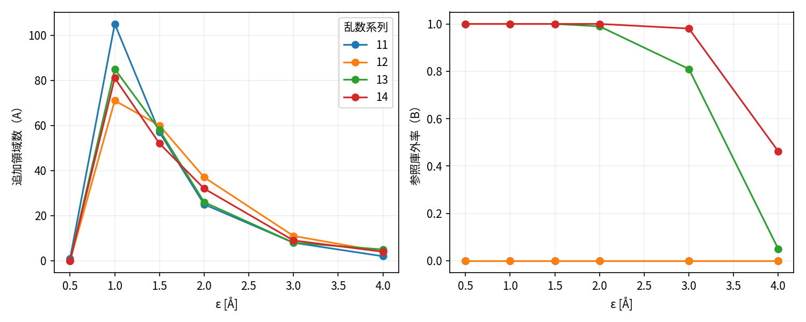

# 新構造領域：二つの候補の比較

ここでいう新規性は構造領域の新規性であり、論文の独創性評価ではない。全て同じ既存MDデータの探索的記述であり、CVAE更新や方策の優劣を比較していない。

## A：主解析結果

100 ps除外、2 ps間隔、τ=5 ps。表は種代表を除いた追加領域数。

| ε Å | 系列11 | 系列12 | 系列13 | 系列14 |
|---:|---:|---:|---:|---:|
| 0.5 | 1 | 0 | 0 | 0 |
| 1 | 105 | 71 | 85 | 81 |
| 1.5 | 57 | 60 | 58 | 52 |
| 2 | 25 | 37 | 26 | 32 |
| 3 | 8 | 11 | 8 | 9 |
| 4 | 2 | 4 | 5 | 4 |

ε=2 Åで隣接する登録代表の角度RMS差中央値は35.45/30.93/41.66/29.22度。距離差に主鎖変化が対応する例はあるが、エネルギー盆地や有益な科学発見を証明しない。ε=0.5から1 Åで計数が増える理由は[閾値報告](threshold-calibration.md)に記した持続条件の非単調性である。

### 標本化と緩和

ε=2 Å、τ=5 ps、100 ps除外、間隔0.5/1/2/5 psの追加数：11=26/27/25/27、12=39/42/37/41、13=29/29/26/30、14=31/31/32/28。この条件では保存頻度だけに比例して増えてはいない。しかし全尺度での安定性を意味しない。

同じ2 ps条件で500 ps除外にすると20/28/22/26、0 ps除外では26/41/29/33。初期区間を除いても全変化が消えるわけではないが、絶対値は変わる。主解析の1 ns窓ごとの登録数（種を含む）は、11=12/5/4/5、12=22/3/5/8、13=12/8/5/2、14=10/12/9/2。後半に登録が続く系列もあり、一律に飽和したとは言えない。初期松弛だけではないと因果分解できたわけでもない。

### 順序依存と別法

τ=0、2 ps間隔、ε=2 Åで順方向/逆方向/シャッフルの代表数は11=41/43/34、12=58/61/55、13=45/44/41、14=40/37/39。時刻を壊すシャッフルには持続時間を適用しない。代表選択は厳密な客観的状態分割ではない。代表数だけでなく代表IDも保存する。

最大512点の固定抽出に対する最遠点被覆は、ε=2 Åで系列11の34代表、最大被覆距離1.995 Å。分割最近傍と厳密小行列の差は全24条件で0だった。この比較は距離計算の数値検証であり、Aの状態数を正解に一致させた検査ではない。最遠点法も固定開始ID・tie規則に依存し、任意の入力順に対する不変性を認証していない。

## B：固定庫の結果

11/12から作った固定庫。校正系列の庫外率0は構築上当然であり汎化成功ではない。

| ε Å | 固定庫代表数 | 13 庫外率 | 14 庫外率 |
|---:|---:|---:|---:|
| 0.5 | 3,678 | 100% | 100% |
| 1 | 854 | 100% | 100% |
| 1.5 | 241 | 100% | 100% |
| 2 | 99 | 98.974% | 100% |
| 3 | 25 | 80.974% | 98.051% |
| 4 | 10 | 4.974% | 46.205% |

4 Åでは13/14とも10代表中9代表を訪問していても庫外率は異なる。訪問代表数だけでは未知領域を説明できない。庫外率を下げるためだけにεを粗くすることも認められない。R1と構庫標本化・対象が異なるため、同じεでもR1表と同じ数値になるとは限らない。

## 用途別の比較（DERIVED）

| 論点 | A：増分登録 | B：固定参照庫 |
|---|---|---|
| 未知領域 | 新代表を追加できる | 庫外として別記する |
| 再現条件 | 履歴、順序、ε、τ、標本化を固定 | 校正庫・閾値を固定 |
| 主な欠点 | 持続/順序依存、非単調性、松弛の混入 | 別系列の代表性不足、有限庫の飽和 |
| オンライン性 | 登録を支持確認時まで遅延 | 最近傍照合で実行可能 |
| 科学的資格 | 現在は記述的候補 | 現在は有限庫診断 |

Aを無条件に上位としない。現状ではAもBも唯一の確認的成果指標として不十分。局所変化を表す補助診断としては利用できるが、正式なB/C成果に使う前に独立の尺度・品質確認が必要。

完全な代表ID/確認時刻：[primary-regions.json](../执行证据/2026-10-26-gq-r2/primary-regions.json)。全表：[sensitivity.csv](../执行证据/2026-10-26-gq-r2/sensitivity.csv)、[固定庫](../执行证据/2026-10-26-gq-r2/fixed-library.json)、[順序](../执行证据/2026-10-26-gq-r2/order-sensitivity.csv)、[小標本の厳密照合](../执行证据/2026-10-26-gq-r2/exact-reference.json)。
