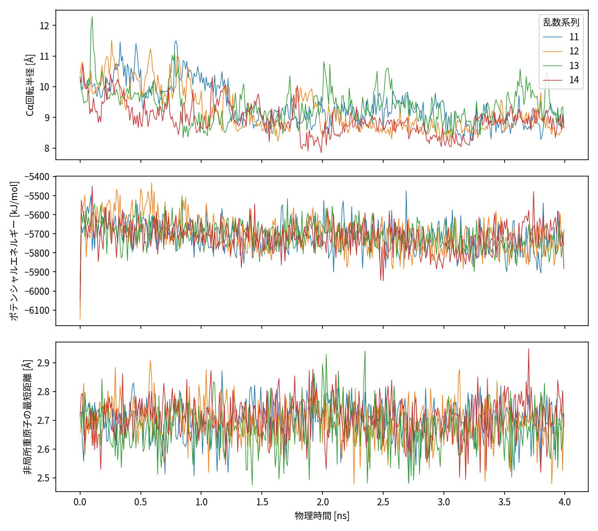

# 構造品質、緩和、入力の資格

## 対象と出所

FSD-EY（PDB 1FME）、DeepDriveMD固定版b18dacba由来のunfolded準備構造、504原子/28残基/28Cα。元入力SHAはR1の準備記録を参照。R1のNoCutoff・Amber14-all/GBn2、300 K、2 fs、HBonds、拘束許容誤差10⁻⁵、Langevin摩擦1 ps⁻¹の4系列である。既存の1 ns＋3 ns継続を連結したが、MDは一切追加していない。GPU/軌跡作成条件は[R1物理プロトコル](../P1-GQ/physics-protocol.md)の履歴を維持する。

本輪はDCD/PDB/CSV/System XML/resultの40ファイルと既存8特徴配列を照合。終了時にはR1の263原資料全てをSHA再照合した。全原子の順序識別子列のSHAも全区間で一致した。特徴/角度は100 psごとに元DCDから独立再計算し、最大差はいずれも0だった。特徴を全点再計算したという主張ではない。

## 全フレームでの粗い幾何警報

32,000/32,000フレームが登録済み警報条件を通過し、除外理由は全て0。R1では5 psごとの抽出だった重原子近接と手性を、本輪では全点で検査した。

| 検査 | 実測範囲・最大値 | 解釈 |
|---|---|---|
| 隣接Cα距離 | 3.573–4.137 Å | 登録範囲2.5–5 Å内 |
| ペプチドC–N | 1.207–1.462 Å | 登録範囲0.8–2 Å内 |
| System拘束長誤差 | 最大8.517×10⁻⁶ Å | 0.01 Å警報以下 |
| 非隣接残基間重原子距離 | 全点最小2.395 Å | 0.8 Å以下の明白な衝突なし |
| 相対手性符号 | 反転0 | 最初の準備構造に対する相対検査 |
| 座標・54主鎖角 | 非有限0 | Ramachandran分布の生物学的認証ではない |

原子個数や有限値だけでは科学的妥当性を認定しない。品質条件は保守的な工学的警報であり、文献がこれら全数値を推奨したという意味ではない。拘束値は保存されたSystem XMLの実値。手性は26個のCβを持つ残基を対象とし、Glyや初期L配置の絶対認証を含まない。全角を一律のallowed-boxで除外していない。

## 緩和と時間変化

| 系列 | 平均温度 K | 先頭100 psの平均Rg Å | 最後100 psの平均Rg Å |
|---|---:|---:|---:|
| 11 | 299.998 | 10.046 | 8.948 |
| 12 | 300.227 | 10.174 | 8.573 |
| 13 | 299.979 | 10.164 | 9.134 |
| 14 | 299.908 | 9.907 | 8.791 |

温度が約300 Kでも構造分布の平衡化を証明しない。特に11/12/13ではポテンシャルの時間推移にも準備後の変化が残る。Langevin系でエネルギー保存を合格条件としていない。中央値±10MADの高エネルギー警告は各系列別に保存し、警告を理由に探索結果を有利に削除していない。

各系列の0/100/200/500 ps除外後の残フレームは8,000/7,800/7,600/7,000、保存フレームが代表する時間量は4.0/3.9/3.8/3.5 ns。これは独立標本数ではない。100 ps除外を十分な平衡化と認定しない。500 psにしても初期準備依存を解消した証拠はない。

## 残る物理リスク

unfolded作成・質子化pH・末端処理の完全な作業履歴、当該系に対するGBn2/NoCutoffの領域専門家による妥当性確認、十分な初期緩和、異なる準備条件への一般性はUNVERIFIED。NoCutoffは本データの候補条件であり物理的真値ではない。座標reseedと連続checkpointは異なり、今回の延長は後者。非周期系なので距離に最小像補正を適用していない。

証拠：[品質全表](../执行证据/2026-10-26-gq-r2/quality-summary.json)、[入力照合](../执行证据/2026-10-26-gq-r2/input-verification.json)、[100 psブロック](../执行证据/2026-10-26-gq-r2/physical-blocks.csv)、[R1保存確認](../执行证据/2026-10-26-gq-r2/r1-preservation.json)。
