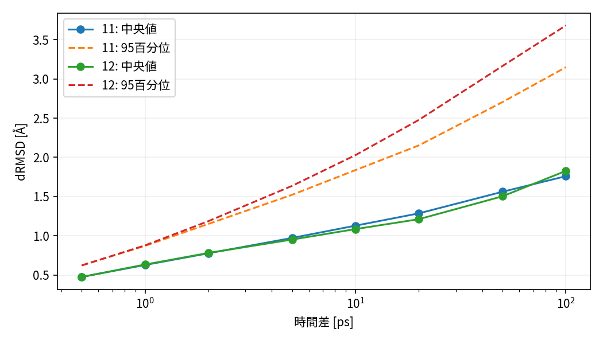

# 分解能の校正と識別不能な部分

## 事前候補と校正境界

ε=0.5/1/1.5/2/3/4 Å、支持時間τ=0/2/5/10 ps、保存間隔0.5/1/2/5 ps、除外0/100/200/500 psを解析前に登録した。11/12を校正系列とし、13/14の結果に合わせてεを選んでいない。ただし13/14も既知データであり、本輪全体は探索的である。

## 時間差と構造差（MEASURED）

100 ps以降の距離分布。p95は重なる時差ペアの記述分位点であり独立試行の不確実性ではない。

| 時差 ps | 11 中央値 Å | 11 p95 Å | 12 中央値 Å | 12 p95 Å |
|---:|---:|---:|---:|---:|
| 0.5 | 0.475 | 0.623 | 0.474 | 0.621 |
| 2 | 0.776 | 1.151 | 0.780 | 1.186 |
| 10 | 1.128 | 1.837 | 1.085 | 2.028 |
| 100 | 1.759 | 3.149 | 1.827 | 3.681 |

対応する主鎖角RMS差の中央値は0.5 psでも17.12/17.43度、100 psで32.99/33.06度。短時差は純粋な熱雑音の独立標本ではなく、連続構造変化も含む。0.5 Åは保存間隔0.5 psの中央値程度であり、局所領域の持続判定には厳し過ぎ得る。

## 数値誤差・熱揺らぎ・局所変化

剛体変換後のd差は約1.7×10⁻¹⁵ Åで、判定容差10⁻¹⁰ Åより小さい。人工Cαガウス摂動σ=0.01/0.05/0.1 Åの対元構造距離の中央値は0.0143/0.0709/0.1413 Å。この対照は算術実装の挙動であり、実MDの熱雑音分布を生成したものではない。DCD由来座標の記録精度とも区別する。

観測された距離は時差とともに連続して増え、二つの独立した「熱のみ/科学的局所変化」分布や明確な谷をこのデータだけで認定できない。1.5–3 Åは今後の検討範囲になり得るがPROPOSEDに留める。2 Åを正式閾値に選んだという意味ではない。粗い4 Åも真の局所状態を十分に区別する証拠がなく、庫外率が下がるという理由では選べない。

## 持続条件による非単調性（重要な負の結果）

τ=5 ps、間隔2 ps、100 ps除外では、ε=0.5 Åの追加領域が系列11/12/13/14で1/0/0/0であるのに、ε=1 Åでは105/71/85/81になる。小さい球の中で連続支持が成立しにくいためであり、小εで探索が無かったという意味ではない。τ=0の細尺度では最大4,743領域まで増える。この二極化により、εとτを独立に物理認証できていない。

本輪から唯一の閾値・支持時間を凍結する科学的根拠は不足。全候補結果を保持し、都合のよい中間尺度だけを正式成果に採用しない。新しい独立校正データと領域専門家の判断、未知系列に対する負対照/安定性検査を経て事前凍結する必要がある。

証拠：[校正全表](../执行证据/2026-10-26-gq-r2/calibration.json)、[系列間距離](../执行证据/2026-10-26-gq-r2/cross-stream.json)、[全1,536条件](../执行证据/2026-10-26-gq-r2/sensitivity.csv)。初期100 ps内の100 ps時差は0対なのでnullとし、失敗履歴も保管した。
