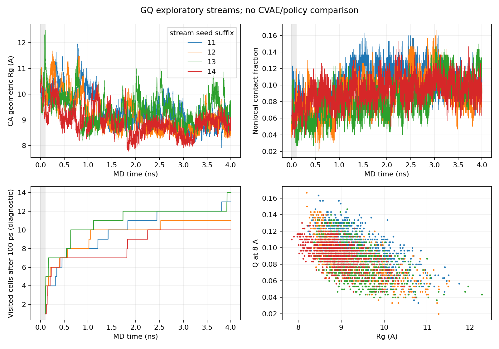

# 独立随机流、连续延长与结构诊断

2026-10-26｜MEASURED / DERIVED，探索性。对象、参数、来源与seed见[计划](analysis-plan.md)及[物理协议](physics-protocol.md)。不同随机流共用同一准备结构，不能把帧或续算分段作为独立实验。

## 可观察的构象信号

| seed | 1ns主投影格子数 | 4ns主投影格子数 | 全4ns相对首帧dRMSD中位/最大Å | 平均温度K |
|---|---:|---:|---|---:|
| 2026102611 | 8 | 13 | 5.345/6.607 | 299.998 |
| 2026102612 | 8 | 11 | 5.303/6.773 | 300.227 |
| 2026102613 | 10 | 14 | 4.710/7.832 | 299.979 |
| 2026102614 | 7 | 10 | 5.811/7.346 | 299.908 |

格子使用Rg1Å/Q0.05/接触8Å/原点0、每0.5ps、排前100ps。1ns是同根前缀，不能作独立对照；投影U不是亚稳态数。dRMSD为325个非局部Cα距离的RMS差，不是对齐RMSD，单位Å；该项对首帧的分布含全部帧，不能混同已排100ps的格子计数。

延长段相对自身首帧的backbone周期角差，中位约15–21°、95分位约88–157°。结合内部距离变化，不能把所有变化解释成刚体运动或极小坐标扰动；但它们仍可能包括展开初态的松弛/压实，不能据此宣布发现新亚稳态或折叠途径。图中Rg缓慢压实且根间路径不同，没有平衡认证。

灰区为前100ps；Rg/Q和散点保留完整原始范围，覆盖曲线按主表排除灰区。横轴是MD物理时间，不是墙钟或科学加速比。

## 质量与相关性

全部11段MD原子/帧数/坐标/日志完整，能量和角度有限。最大约束距离残差约8.51×10⁻⁶Å；当前肽链C–N/Cα间距和采样重原子距离未触发工程警报，采样侧链手性未见翻转。重原子和手性检查每5ps，不能声称覆盖了所有原子在所有时刻的化学验证。

四条1ns的Rg lag1相关约0.972–0.979（采样0.5ps）；最终分段/分块诊断保留全部值。没有因抽帧就宣称独立，也没有在未证稳态时用自相关估计平衡ESS或给帧级p值。温控均值接近300K不是采样充分性证据；Langevin体系不以总能量严格守恒作为验收标准。

每根初始1ns含前100ps松弛候选，续算3ns未重新最小化/生成速度。续算的initial.pdb是拓扑载体，真实起点是已验证SHA的checkpoint；不能把其中PDB坐标误解为续算时重用展开初值。所有新原始结构、checkpoint、seed和时间边界保留。

对当前体系的有限判断：1–4ns能产生可辨几何/二面角变化，计算成本可控；尚不能把这些变化全部解释为已合格科学探索，而非准备依赖。需要认可其物理含义和评价尺度后才可测更新作用。
