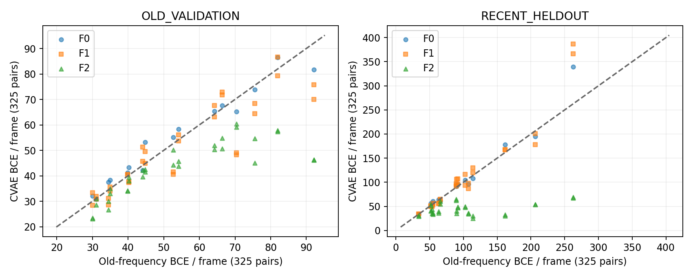

# L1：既存200歩CVAEの凍結表現資格診断

2026-10-29 JST。基準6730e493bddce42fb4d86ed93fab05cc88810268、計画/コード3054dafaece0fd855c397b6fb21e91a3d815fa30、前向前のID凍結296752d（完全SHAはGit履歴）。新訓練/MD/LOFなし。

## Executive Summary

**80モデル全ての実行完全性と同一CPU条件の決定性はPASS。再構成には限定的な非自明性の支持があるが、表示の物理近傍保存・学習seed間安定性まで全面合格とは判定しない。** 全モデル/二集合/三掩码を維持した。F2は共通旧頻度より良いことが多い一方、各臂の訓練頻度との比較では優位が一様でなく、3次元潜在の物理近傍重複は元接触図や時刻近傍より低い。収束・科学探索改善・C・B2は未検証である。

## 1. 問い、承認範囲と版

研究者が承認したのは既存最終checkpointのread-only eval/no_grad評価である。[計画](analysis-plan.md)。モデルの入力/重み/optimizer、B1/R1/Q0の記録を変更していない。未学習モデル、新しいcheckpoint、最適なepochを選び直していない。80モデルは16状態・8歴史根に入れ子で、80独立実験ではない。M0がF0であり二重計数しない。

CONFIRMEDは限定作業の承認、MEASUREDはSHA/前向/資源の実読取り、DERIVEDは以下の記述比較、UNVERIFIEDは収束・十分な科学表現・物理妥当性。方法/数値は結果前に固定した実装仕様で、科学的合格閾値が研究者に承認されたという意味ではない。

## 2. 入力監査と環境

80 checkpointのバイトSHA、recipe/exposure/resultと16 decision-poolのindices/contacts/featuresを凍結前に検査した。[凍結SHA](freeze-input-sha256.json)。さらにCPUロード時にmodel/optimizer tensor digestを原記録と照合し、model stateの全値有限性、全てのキーのstrict復元、200歩の記録を確認した。[全80チェック](checkpoint-audit.csv)、[Q0系譜](../P1-Q0/model-lineage.csv)、[原モデル索引](../执行证据/2026-10-26-b1-expansion/models.json)。optimizerは保存値のdigest照合だけで、インスタンス生成/stepはしない。

Python3.12.3、既存Torch/NumPyは[execution-status](execution-status.json)、既存mdlearn938cb80の固定クラスを使用。[期待ソースSHA](expected-mdlearn-sha256.json)をインストール済み5ファイルと実照合した。入力contactは旧binary COOを復元し、モデルの科学仕様を変更していない。[固定VAE](../../vendor/mdlearn-938cb80/mdlearn/nn/models/vae/model.py)、[固定CVAE](../../vendor/mdlearn-938cb80/mdlearn/nn/models/vae/symmetric_conv2d_vae.py)。

共有設備のCPU/メモリ/GPUを実行前に読取確認し、低い負荷と約119GB利用可能RAMを確認。GPU不可視、CPU affinity1、数値thread1、batch32、nice10。RSS2GiB/出力1GiB/累計2時間復核点の監視を継続した。新環境や共有システム設定の変更はない。

## 3. 評価ID、時刻合法性、依存性

[6,400 ID行](validation-ids.csv)と[集合](frozen-cohorts.json)は前向評価前にGitHubへpush済み。各状態で5モデルが同じ二つの200点集合を使った。全て各モデルのtraining exposureとID非重複である。

- OLD_VALIDATION：旧登録の200 validation、b=2/6nsより前。
- RECENT_HELDOUT：(b+1.7,b+2.0]nsに相当する既存validフレームから順序だけで等間隔200点。追加訓練new窓は(b,b+1.6]なのでF2にも未提示。モデル結果やB1下流成果を見てIDを選んでいない。

両集合は決定4/8ns時点までに存在する。M0の公開bに対する後者は**事後汎化診断**で、当時のオンライン利用可能情報ではない。F2の新側近くの同一履歴blockであり、時間相関・分布類似がある。ID非重複を統計的独立や外部root汎化と同一視しない。近い構造の重複そのものを排除した設計でもない。全ての既存根は既知データの探索的資格診断である。

## 4. 数学的定義・基線

Y∈{0,1}^{28×28}、p=D(mu(Y))。R_M(Y,p)=−Σ_(i,j)∈M[Y log p+(1−Y)log(1−p)]。単位はnats/フレーム、R_M/|M|を有効接触要素当たり誤差と呼ぶ。有効は予測された正例だけでなく、固定掩码内の正/負全要素を指す。ALL=784、NONLOCALはi<j, j−i≥3で325、LONGはj−i≥4で300。ALLの対称重複/対角の容易さから結論を出さない。全三条件を[480モデル行](model-metrics.csv)と[288状態行](state-metrics.csv)へ残した。

基線は各要素の一定頻度p=(接触count+0.5)/(800+1)。共通OLD800と各臂の実訓練800を別々に算出した。同一検証集合のleave-one-out頻度はp_n=(他199点のcount+0.5)/200。自己ラベルは除くが、他の評価点とその時間相関を用いる**transductiveな楽観的参考**であり、オンライン方策の基線や独立テストではない。閾値accuracyを使わずBCEを比較した。

KL_n=0.5Σ_l(mu_nl²+sigma_nl²−1−2log sigma_nl)、sigma=exp(logstd)は固定コードのmax logstd10を維持する。sample平均なのでQ0のbatch平均の末尾8重みとは異なる。潜在mean、母分散Var(mu)、E[sigma²]、次元KL、mu共分散固有値を[次元別](latent-diagnostics.csv)・[固有値](covariance-eigenvalues.csv)に示す。大きなKLだけを情報量の証明にしない。

zero潜在の復号も比較したが、非zeroの定数muだけでもzeroとの差は生じる。その差だけでは入力依存情報を証明できない。平均muへの置換、未学習ネットワーク比較、相互情報推定は本輪では実施しておらず、この限界を残す。後から有利な検査を追加しない。

## 5. 再構成の結果

以下はNONLOCAL325のBCE/フレームの記述平均（低いほど当該BCEが小さい）。複数seedは同じ状態内の対応モデルであり、独立母集団の平均推定や検定ではない。

|集合|臂|モデル|CVAE|共通旧頻度|臂別訓練頻度|検証LOO|旧頻度より低い|訓練頻度より低い|
|---|---|---:|---:|---:|---:|---:|---:|---:|
|OLD_VALIDATION|F0|16|54.5103|53.5420|53.5420|26.8350|5/16|5/16|
|OLD_VALIDATION|F1|32|50.3339|53.5420|53.5420|26.8350|18/32|18/32|
|OLD_VALIDATION|F2|32|42.5216|53.5420|45.2114|26.8350|31/32|20/32|
|RECENT_HELDOUT|F0|16|105.3166|100.0909|100.0909|22.5602|5/16|5/16|
|RECENT_HELDOUT|F1|32|107.0408|100.0909|100.0909|22.5602|17/32|17/32|
|RECENT_HELDOUT|F2|32|44.3003|100.0909|51.7919|22.5602|31/32|20/32|

F2のrecentにおける共通旧頻度との差だけでは、新データに接近した分布に適応した寄与と、フレーム毎の非自明再構成を区別できない。臂別頻度比較ではold/recentとも20/32が低い。F0は各集合5/16で、200歩M0全体の安定した優位は示されない。validation LOOには全モデルが及ばなかったが、LOO側は評価blockの他点を見るので、これを公平なオンライン勝敗や正式不合格基準にもしない。

反例・悪化モデルも[完全表](model-metrics.csv)に含める。Q0の訓練lossとL1最終checkpointの再構成は、時点・mode・正規化・CPU/GPUが異なる。生total同士の比較や「訓練より検証が良いので汎化」とはしない。

## 6. 潜在幾何と学習seed間安定性

既存325対Cα内部距離ベクトルf(x)に対し、d_phys(x,y)=||f(x)−f(y)||₂/√325 [Å]。潜在はmuのEuclidean距離。200点の上三角19,900対のSpearmanと、各点10最近傍の集合重複率 |N_z∩N_phys|/10 を記述した。対は共有点と時間相関を持つため、19,900独立観測のp値を出していない。tiesはID順に固定した。

|集合|臂|物理距離とのSpearman|物理10近傍重複|時刻近傍の物理重複|接触近傍の物理重複|
|---|---|---:|---:|---:|---:|
|OLD_VALIDATION|F0|0.2654|0.1246|0.3767|0.3800|
|OLD_VALIDATION|F1|0.3264|0.1354|0.3767|0.3800|
|OLD_VALIDATION|F2|0.3592|0.1393|0.3767|0.3800|
|RECENT_HELDOUT|F0|0.2560|0.1092|0.3466|0.3458|
|RECENT_HELDOUT|F1|0.2957|0.1162|0.3466|0.3458|
|RECENT_HELDOUT|F2|0.2992|0.1221|0.3466|0.3458|

RAWの平均では物理近傍重複0.109–0.139程度で、入力接触や時刻近傍の約0.346–0.380より低い。潜在は3次元圧縮、接触は325次元なので同じ容量の学習法比較ではないが、「潜在近傍がよく物理構造を保つ」という主張は支持しにくい。時刻近傍も強いことは同一短blockの相関による見かけの一致を示す重要な対照である。

潜在次元を同じ評価集合で標準化した感度も[geometry-overview](geometry-overview.csv)に全て公開した。rawよりやや高い場合があっても、分散の小さい次元の雑音を拡大し得る。標準化を本研究のオンラインLOFへ採用していない。物理距離もCα粗視化で、側鎖/鏡映等の表現限界がある。

[全64 seed比較](seed-stability.csv)は、各F1/F2のt1/t2について潜在距離rank相関と10近傍重複を比較する。モデル間のmu座標を直接引いていない。r07-s4ではOLDのF1 rank相関0.9202/近傍0.4840、F2は0.8610/0.3750、RECENTではF1 0.9337/0.4345、F2 0.8226/0.3095だった。大域距離rankが高くても局所近傍は一致しきらない。二seed・同じM0だけなので、独立初期化に対する安定性を認定しない。

## 7. r07-s4-M0と四子モデル

過去の単歩loss尖峰があった根を除外せず、同じ集合/掩码で次を得た。BCEはNONLOCAL325、KLは3次元和/sample。

|集合|モデル|CVAE BCE|旧頻度 BCE|訓練頻度 BCE|KL/枚|zero復号 BCE|
|---|---|---:|---:|---:|---:|---:|
|OLD_VALIDATION|M0|55.1419|52.6489|52.6489|2.8011|83.9121|
|RECENT_HELDOUT|M0|107.9455|114.1262|114.1262|2.7732|102.5402|
|OLD_VALIDATION|F1-t1|40.5815|52.6489|52.6489|5.4695|56.2870|
|RECENT_HELDOUT|F1-t1|129.6019|114.1262|114.1262|6.5669|94.8261|
|OLD_VALIDATION|F1-t2|41.5906|52.6489|52.6489|5.9595|58.0572|
|RECENT_HELDOUT|F1-t2|119.7336|114.1262|114.1262|7.0995|96.0711|
|OLD_VALIDATION|F2-t1|44.1762|52.6489|55.2441|5.0173|60.0298|
|RECENT_HELDOUT|F2-t1|30.4737|114.1262|46.5984|6.3521|67.2839|
|OLD_VALIDATION|F2-t2|50.1670|52.6489|55.2441|6.8597|56.7132|
|RECENT_HELDOUT|F2-t2|25.1686|114.1262|46.5984|9.5410|65.5892|

最終M0の全重み・前向は有限で、OLDのKL2.8011、RECENT2.7732。OLDの三次元mu分散は[0.006167,0.001620,0.001621]、E[sigma²]は[0.115400,1.133868,0.238400]。第1次元（index1）のKL平均は0.011657で、他二次元と利用の偏りがある。これは部分的な未使用リスクの診断であり、閾値によるcollapse認定ではない。非zeroのmu平均やposterior varianceのずれでKLが出ても入力情報が豊富とは限らない。

M0のRAW物理近傍重複はOLD0.1110、RECENT0.0765。F2のrecent BCEは二子で30.4737/25.1686に低下するが、物理近傍重複0.1065/0.1080に留まる。一方F1のrecent BCEはM0より悪く、zero復号よりも悪い。再構成、幾何、seed安定性の評価は一枚岩ではない。最終モデルが有限であることを過去の尖峰が無害だった証明にしない。

## 8. 決定性・不変性・失敗/欠測

全80 checkpointのtensor/optimizer digestが原記録と一致した。eval/no_grad、requires_grad=Falseと逆伝播/stepの拒否guardを使用。各batchを二回前向し、mu/再構成は同一CPU/同一batch条件でbit一致。前後のmodel digestとcheckpoint SHAも全80一致した。他機種/GPU・異なるbatch間のbit保証ではない。

本輪の計算エラー・未完了モデル・非有限出力は0。[execution-status](execution-status.json)と[checkpoint-audit](checkpoint-audit.csv)。未実施は収束曲線、別root validation、新しい初期化、平均潜在ablation、decoder情報依存の厳密推定、科学成果評価。CSVのDIMENSION行に距離列が空である等の非該当空欄は、モデル評価失敗と区別する。

[モデル別/frame別](frame-diagnostics.csv)、[全ID](validation-ids.csv)、[入力SHA](freeze-input-sha256.json)、[追加配列SHA](array-sha256.json)で追跡できる。再構成全配列・mu/logstdは新L1サーバ領域に保持し、公開側は表・図・SHAのみ。原9archiveを削除せずMac原backupも再導入しない。

## 9. 費用・再現

[全stage台帳](cost-ledger.json)：freeze wall3.872017s/CPU3.870957s、evaluate wall134.207111s/CPU134.157537s、summary/図 wall0.801959s/CPU0.785876s。主前向工程の峰RSS721.449MiB。数値stage全体は約139s、2時間復核点未到達。SSH・Git・転送・文書作成を含む総経過時間とは区別する。RSSと仮想アドレス空間も別物である。

[主実装](../../p1/l1_frozen_diagnostic.py)のSHA845d8b579793465b86a9193855c0adebbab14f2c1ea879e26086597abe15d100、[表/図生成](../../p1/l1_report_tables.py)のSHAは台帳。旧環境を再利用、パッケージ更新なし。freeze→ID push→evaluate→summaryの順序を守った。[再現手順](reproduce.md)。

## 10. 科学的判定と停止

|層|本輪の判断（DERIVED）|まだ言えないこと|
|---|---|---|
|モデル実行完全性|技術PASS、80/80|モデルが十分訓練された|
|再構成資格|部分的支持、F2の臂別頻度優位は20/32。M0は限定的|全状態/分布で非自明性が確実|
|表現資格|物理距離との弱〜中程度の関連はあるが局所近傍保存/seed安定性は限定的|良い科学反応座標、collapseなし、表示全面PASS|
|科学探索価値|NOT TESTED|B1改善、C成立、B2純利益|
|次段階|研究者/ChatGPT審査待ち|L2/P/O/C/B2の計算承認|

この診断は現モデルを無価値と断じるものでも、収束・性能を認定するものでもない。研究者は、限定ベンチマークとしての現表現の採用範囲と、次に必要な最小資格検査を判断する。方法の変更や新訓練は本輪では提案を実行に変えない。[A–G引継ぎ](handoff-to-chatgpt.md)を交付し停止する。
