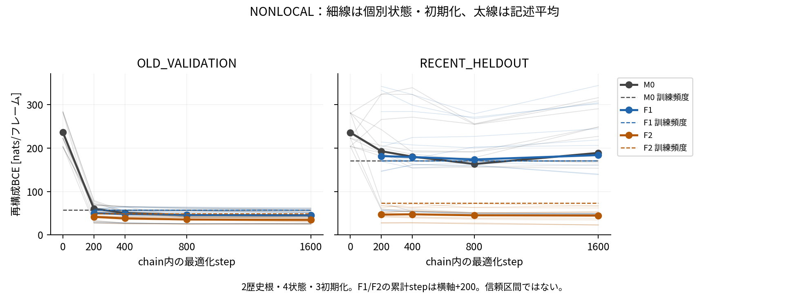
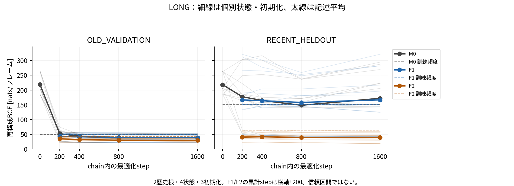
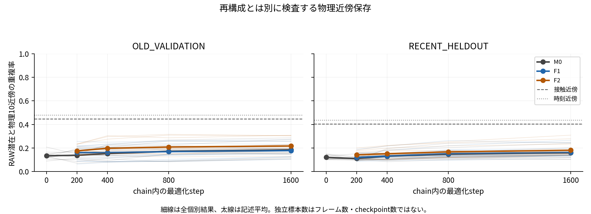

# P1-L2 科学審査報告：学習量・初期化とCVAE潜在表現

2026-10-30 JST。状態：**科学計算COMPLETE、結果監査PASS、表現資格は部分的支持／INCONCLUSIVE、独立科学審査・研究者受入れPENDING**。

## Executive Summary

研究者が承認したL2-design-v1を変更せず、既知の2歴史根・4状態、3初期化、M0/F1/F2の36学習chainと156評価点を完了した。新規optimizer stepsは57,600、訓練提示230,400。新しいMDは0である。[完了集計](summary.json)、[実行状態](execution-status.json)。

F2のRECENT再構成は強く改善した。一方、長期学習の効果は単調でも全条件共通でもなく、局所潜在幾何と候補順位の初期化安定性には限界が残る。最終1600歩の事前判定48セルで、再構成・入力依存・未学習より高いRAW幾何を同時に満たすのはM0 26/48、F1 26/48、F2 45/48である。どの条件群も全セル一致の見出し基準を満たさず、全面合格や収束とはしない。[判定全セル](decision-cells.csv)、[判定集計](qualification-checks.json)。

特にr02-s8-i2-M0は第5歩にtotal 242,687,488、KL平均242,598,880という有限の巨大値を記録した。異常chainを除外・差し替えず全結果へ含めた。最終checkpointが有限であっても、学習が安定・十分であるとは言えない。[原1600行](loss-spike-case-r02-s8-i2-M0.csv)、[事例とSHA](loss-spike-case.json)。

本報告は学習資格の開発診断である。新Top1に対応する下流MDは全てNOT_OBSERVED。科学探索改善、CのX追加価値、B2の固定wall-clock純利益を示す実験ではない。旧B1/R1/Q0/L1の科学条件・結果は変更しない。

## 1. 問い、仮説、事前境界

CVAEはconvolutional variational autoencoder（畳み込み変分自己符号化器）を意味する。問いは、同じ有限データと固定ネットワークに対し、200歩を超える学習と独立初期化が、再構成、入力固有情報の利用、物理近傍保存、LOF選択にどう現れるか、である。

[事前分析計画](analysis-plan.md)、[行列・乱数](experiment-design.md)、[指標契約](metric-contract.md)、[判定規則](decision-criteria.md)は設計commit `8d34e3714e246afb0bd74fe6943abeafd8f89c5b` で固定され、[研究者の限定実行承認](execution-approval.md)を受けた。設計本文に残るPROPOSED／実行しないという記述は設計時の履歴であり、この限定行列は承認済みである。正式研究方針を変更する意味ではない。

|事前の問い|実施した対応比較|主張の上限|
|---|---|---|
|H-step：200歩以降に有用な変化があるか|同chainの全中間増分と1600−200|有限セルでの条件付き変化。十分収束の認定不可|
|H-init：初期化で表現が変わるか|3初期化の全3対、同状態/条件群/歩数|単一更新stream下の学習履歴全体の違い|
|H-info：頻度適応以上の入力依存があるか|条件群別頻度・平均コード・全5対応入替え・未学習対照|有限集合での非自明性。相互情報推定ではない|
|H-selection：候補選択が変わるか|同FULL候補・密度集合で全予定対比|順位・起点の感度。下流利益は未観測|

B1下流探索値を用いた最適seed・step・親・評価集合の選択、early stopping、追加MDは行わなかった。既に見たL1集合を再使用したため、今回の結果は未知の確認標本ではない。

## 2. 対象、入力系譜、時間合法性

科学対象はFSD-EY／PDB 1FME、原B1のNoCutoff OpenMM履歴から既に生成された非周期Cα接触図（8 Å、28×28）である。本輪にDCD再処理や物理条件変更はない。[元MD・学習資格](../P1-Post-R1-Qualification/qualification-review.md)、[Q0](../P1-Q0/review-dossier.md)、[L1](../P1-L1/review-dossier.md)の未解決事項を引き継ぐ。

|状態|M0の物理時刻境界 b|判断時点 d|FULL候補数|
|---|---:|---:|---:|
|r01-s4 / r02-s4|2 ns|4 ns|7,800|
|r01-s8 / r02-s8|6 ns|8 ns|15,800|

M0/F1はOLD800、F2は同OLDの固定400とNEW400の計800 unique ID。F2は「旧800に新400を追加」ではない。各epochは800 IDを一回ずつ提示し、8epochを通じmembershipは変えない。[訓練ID](training-membership.csv)9,600行は4状態×3条件群×800であり、3初期化のため同じ一覧を使用する。

[評価ID](evaluation-ids.csv)は4状態×2集合×200=1,600行。OLDは(b−0.3,b]、RECENTは(b+1.7,b+2]の既存固定ID、新データ訓練窓は(b,b+1.6]。全条件群訓練IDと非重複だが、近接時刻の構造相関は残る。RECENTはd時点で存在するが、M0を作ったb時点には未来のため、M0に対する評価は**事後汎化診断**である。M0のオンライン選択にその情報が使えたと解釈しない。

[入力凍結](input-freeze.json)と[終了監査](integrity.json)は、使用した原108ファイル（16 PDB、12 pool、20既存モデルtaskに関する80記録）のSHA、28 Cαの原子順、ID、時刻を検査した。既存80個の全重みと9archive全体を本輪で再hashしたという意味ではない。既存9archiveは保持し、Mac raw複製免除も継続した。

## 3. 固定行列、学習条件、版

[36chain](experiment-matrix.csv)は4状態×3初期化×3条件群。各chain1600歩、200/400/800/1600を保存し、12 M0-step0を加えて[156評価点](checkpoint-matrix.csv)となる。未学習重みは3種類を4状態へ適用したもので、12独立初期化ではない。F1/F2は常に同初期化M0-200の完全model＋RMSpropから分岐し、M0-1600からは分岐しない。

|条件群|横軸chain_steps|累積lifetime_steps|親|
|---|---|---|---|
|M0|0/200/400/800/1600|同値|独立初期化|
|F1/F2|追加200/400/800/1600|400/600/1000/1800|M0-200固定|

F0という名称は固定M0-200を指す。M0-1600へ置き換えない。F2−F1は同累積量の比較だが、M0-1600と子1600は累積学習量が異なる。

初期化seedは1700000101/1700000102/1700000103、M0最適化・独立NumPy permutationは1701000001、子F1/F2は1702000001。同seed値でもgeneratorは別object。epoch間RNGは継続しcheckpointごとにresetしない。初期化は状態間で共用した交差因子で、更新streamは1本だけである。

ネットワークは入力1×28×28、4層filters16、kernel3、strides1/1/1/2、affine128、dropout0.5、潜在3。RMSprop lr0.001、weight_decay1e−5、batch4、gradient clipping norm10、num_workers0を保持した。保存recipeの旧API属性epochs=1に対し、独立L2 adapterは明示的に8epoch／1600歩を実行した。実loss/exposure/optimizer counterが実行量の証拠である。構造・損失・学習率・潜在次元・KL重みは探索していない。

|対象|固定版・証拠|
|---|---|
|設計|8d34e3714e246afb0bd74fe6943abeafd8f89c5b|
|入力・学習・前向・人工資格|fea7500e735b6376e23e7cfe89e95bc976ca880e / [release](execution-release.json)|
|制御器ログ修正|79ab95016b881e8294837137985cc77cd2208af4|
|全NumPy状態監査|bd7a0983adf8c0deaf1bb243010587ef1cabc917 / [postprocess release](postprocess-release.json)|
|実optimizer・判定・図v2|a9d42afbc6ae2603c0ab1b06d6f22f63baf9ec86 / [report release](report-completion-release.json)|
|実配備ファイル別SHA|[source-state-sha256](source-state-sha256.json)|

環境はPython3.12.3、Torch2.7.1+cu128、NumPy1.26.4、scikit-learn1.6.1、mdlearn0.0.10a1（固定source938cb80）。GPUは1×RTX PRO6000 Blackwell Max-Q Workstation Edition 96GB、driver590.48.01。Linux6.8.0-138-generic、x86_64。[環境記録](hardware-environment.json)。実importされたmdlearn5ファイルも入力凍結で照合した。CPU前向・LOFはGPU不可視、単worker/thread。共有システム・driver・global Gitは変更していない。

## 4. 数学定義、単位、対照

### 4.1 接触再構成と入力依存

Y∈{0,1}^{28×28}、z=μ(Y)、p=D(z)とする。maskはALL784（対角・対称重複を含む補助）、NONLOCAL325（i<j、j−i≥3、主診断）、LONG300（j−i≥4、必須感度）。LONGは本計画の操作的名称で、一般の蛋白質分類を意味しない。

$$R_M(Y,p)=-\sum_{(i,j)\in M}\{Y_{ij}\log p_{ij}+(1-Y_{ij})\log(1-p_{ij})\}.$$

BCEはnats/フレーム、R_M/|M|はnats/有効要素。正接触・非接触双方を含む。200枚を等重みとし、batch32＋末尾8を等batch重みで平均しない。固定Torch BCEの数値処理を保持した。

条件群別訓練頻度p^train=(count+0.5)/801に対しA_train=平均R(Y,p^train)−平均R(Y,D(μ(Y)))。正なら単純頻度より低BCE。共通OLD800頻度も併記し、F2の分布適応を全て個別構造情報と呼ばない。同集合のleave-one-out頻度はtransductive参考で、オンライン公平基線・合否には使わない。

平均コードbar z=(1/200)Σμ(Y_n)、A_mean=平均R(Y,D(bar z))−平均R(Y,D(μ(Y)))。対応入替えπ_o(n)=(n+o) mod200、o=1/17/53/97/149の全5差A_perm,oを保存した。zero-codeと未学習step0も同集合で評価。A_mean>0かつ全A_perm>0が入力依存の限定支持であり、相互情報や交換可能標本の置換検定ではない。特にoffset1に時間相関が残る。[全936行・分項・全対照](model-metrics.csv)。

### 4.2 KLと潜在幾何

σ=exp(logstd)、固定実装はlogstd上限10。

$$K_n=\tfrac12\sum_{l=1}^{3}(\mu_{nl}^2+\sigma_{nl}^2-1-2\log\sigma_{nl})\ [\mathrm{nats/frame}].$$

各次元の平均KL、μ平均・母分散、Eσ²、μ共分散の3固有値、min/maxを記録した。KLは入力情報量そのものではなく事前分布からのずれも含む。任意のcollapse閾値は作らない。[全936次元行](latent.csv)。

f(x)を325対のCα内部距離[Å]とする。

$$d_{phys}(x,y)=\|f(x)-f(y)\|_2/\sqrt{325}\ [\mathrm{\AA}],\qquad d_z(x,y)=\|\mu(x)-\mu(y)\|_2.$$

自己以外の10近傍についてK10=(1/200)Σ|N_z(n)∩N_phys(n)|/10。範囲[0,1]、無次元、距離同値はglobal IDで解決する。全19,900距離対のSpearmanも保存しp値を出さない。主はRAW、同集合内次元標準化は補助。接触距離と絶対時刻差を基線とした。[全624幾何行](geometry.csv)。内部距離は剛体変換不変だが鏡映を区別せず、側鎖・溶媒・速度や自由エネルギーを表さない。

### 4.3 LOFと判定

RAW μ、FULL E=D、n_neighbors20、Minkowski p2、novelty=False、n_jobs1。negative_outlier_factor_昇順、同値global ID。全score/rank、Top1/10/100、由来・時刻・最小score gap、Top1間d_physを保存した。異なるfitのscore差を校正された不確実性と呼ばない。

最終1600で4状態×3init×2集合×2主mask=48セル/条件群。A_train>0、A_mean>0と全5 A_perm>0、RAW K10が同init未学習より高い、の全てが全セルで成立する場合だけ一貫した限定支持という見出しを許す。厳密な符号規則であり、有意差・実用差・普遍的自然科学基準ではない。幾何はmask間で同値なので48独立幾何反復ではない。

## 5. 実行完全性と監査

|検査|実測結果|証拠|
|---|---|---|
|固定行列|36/36 chain、156/156評価、欠測0|[summary](summary.json)|
|原使用入力不変|108/108 SHA一致、ID/時間/Cα順一致|[freeze](input-freeze.json)、[integrity](integrity.json)|
|checkpointと親|156 digest、24親model/optimizer一致|[checkpoint](checkpoint-audit.csv)、[parent](parent-audit.csv)|
|更新乱数|F1/F2同step全48組一致|[RNG](RNG-pair-audit.csv)|
|実歩数・提示|57,600 loss行、230,400提示|[integrity](integrity.json)、[raw SHA](raw-output-sha256.json)|
|実RMSprop counter|156条件が累積0/200…/1800と一致|[optimizer audit](optimizer-step-audit.csv)、[PASS](optimizer-step-integrity.json)|
|数値有限性|160,248数値セル、非有限0、blank0、欠測単位0|[numeric validation](numeric-validation.json)|
|人工保存再開|CPU連続6歩=3歩+保存再開+3歩、model/optimizer/RNG bit一致|[engineering check](engineering-check.json)|

人工12歩は科学57,600歩へ加算しない。CPU人工復元をGPU中断chainのbit再開試験と同一視しない。実GPU子の親load/digest検査は成功したが、GPUで意図的に中断・再開する別実験はしていない。制御器は成功結果をskipし、不完全directoryを自動上書きせず停止する。

子の開始step0 RNGを独立ファイルには保存していない。同seed再設定は固定ソース、全48組の保存同step RNGは実比較した。後者を開始時点直接snapshotの証拠に置き換えない。全NumPy状態配列をhashし、省略表示reprだけで比較していない。

## 6. 再構成・幾何の全歩数結果

以下は各条件群・stepにつき4状態×3初期化=12モデル集合条件の記述平均。独立科学標本数は2根。BCEはNONLOCALのnats/フレーム、K10はRAW無次元。平均の信用区間ではなく全個別線と平均を図示する。

|条件群|chain歩数|OLD BCE|RECENT BCE|OLD A_train>0|RECENT A_train>0|OLD K10|RECENT K10|
|---|---|---|---|---|---|---|---|
|M0|0|236.143445|235.831490|0/12|3/12|0.134375|0.120500|
|M0|200|60.312640|192.796956|5/12|2/12|0.138125|0.111000|
|M0|400|50.602843|180.284295|7/12|4/12|0.152167|0.130000|
|M0|800|45.964174|163.277186|10/12|11/12|0.172333|0.146625|
|M0|1600|45.250824|188.861153|12/12|5/12|0.183958|0.159542|
|F1|200|49.965514|181.598027|9/12|4/12|0.161167|0.120250|
|F1|400|48.103628|179.381226|9/12|3/12|0.161583|0.132792|
|F1|800|45.942515|173.693588|10/12|7/12|0.169208|0.152542|
|F1|1600|44.976686|183.796058|12/12|7/12|0.178167|0.162583|
|F2|200|41.455233|46.902398|12/12|10/12|0.175833|0.142208|
|F2|400|38.253265|47.488161|12/12|11/12|0.197333|0.151167|
|F2|800|35.572726|45.241040|12/12|12/12|0.208625|0.167167|
|F2|1600|34.642212|44.741664|12/12|12/12|0.217000|0.181083|

出典：[overview全78行](overview.csv)。F2は直近BCEとA_trainが改善するが、M0/F1の直近は800→1600で悪化する。F2も200→400で直近BCEは悪化し、単調とは言えない。M0-1600、F1-1600、F2-1600の母平均比較を学習量だけの効果としない。

図の横軸はchain歩数、子の累積は+200。step0はM0未学習のみ。旧v1再構成図に縦軸切断があり、全CSVから共通最大値を取るv2を正式閲覧対象とした。旧図・値は保存し、科学数値は変更していない。

### 6.1 頻度・入力依存の具体値

最終1600のNONLOCAL、12条件平均。BCE差とKLはいずれもnats/フレーム。

|条件群|集合|頻度BCE|A_train|A_mean|KL|
|---|---|---|---|---|---|
|M0|OLD_VALIDATION|57.087537|11.836713|2.864367|4.727561|
|M0|RECENT_HELDOUT|170.578538|-18.282615|-0.305802|3.285908|
|F1|OLD_VALIDATION|57.087537|12.110851|3.172041|5.376655|
|F1|RECENT_HELDOUT|170.578538|-13.217520|-0.579666|3.367066|
|F2|OLD_VALIDATION|48.889769|14.247557|7.223144|6.099300|
|F2|RECENT_HELDOUT|72.981916|28.240252|2.384266|5.919344|

F2は共通旧頻度を超えるだけでなく、自条件群頻度と平均コードとの差も正の平均となる。一方、平均が正でも全セル合格ではない。各5対応入替え、zero、正接触/負接触寄与、LOOは[モデル全表](model-metrics.csv)に保持した。LOOは同時点評価集合の情報を用い、優位を公平なオンライン利益とはしない。

### 6.2 200→1600：全maskの対応結果

差は1600−200、BCE負/K10正が各診断上の改善。「両方」はその2方向を同時に満たしたモデル集合条件数であり、独立反復数ではない。

|条件群|集合|mask|BCE差|K10差|BCE改善/12|K10改善/12|両方/12|
|---|---|---|---|---|---|---|---|
|M0|OLD|ALL|-30.843992|0.045833|12|11|11|
|M0|OLD|NONLOCAL|-15.061816|0.045833|12|11|11|
|M0|OLD|LONG|-13.381242|0.045833|12|11|11|
|M0|RECENT|ALL|-6.303195|0.048542|8|10|7|
|M0|RECENT|NONLOCAL|-3.935803|0.048542|9|10|8|
|M0|RECENT|LONG|-5.272368|0.048542|9|10|8|
|F1|OLD|ALL|-10.202140|0.017000|10|9|7|
|F1|OLD|NONLOCAL|-4.988828|0.017000|10|9|7|
|F1|OLD|LONG|-4.421758|0.017000|9|9|6|
|F1|RECENT|ALL|7.548763|0.042333|6|11|5|
|F1|RECENT|NONLOCAL|2.198031|0.042333|6|11|5|
|F1|RECENT|LONG|0.159419|0.042333|6|11|5|
|F2|OLD|ALL|-13.759723|0.041167|12|9|9|
|F2|OLD|NONLOCAL|-6.813021|0.041167|12|9|9|
|F2|OLD|LONG|-5.476693|0.041167|12|9|9|
|F2|RECENT|ALL|-3.993973|0.038875|7|9|7|
|F2|RECENT|NONLOCAL|-2.160734|0.038875|8|9|7|
|F2|RECENT|LONG|-1.569036|0.038875|6|9|6|

[全中間増分・全対照・未学習/固定F0対比](paired-contrasts.csv)3,960行、[200→1600要約](step-improvement-summary.csv)18行。F1直近NONLOCALはBCE平均+2.198031で悪化する一方K10は+0.042333。F2直近はBCE改善8/12・K10改善9/12・両方7/12。再構成と幾何を一つの改善にまとめない。200歩の先に有用な変化がある条件は支持されるが、200歩が全条件で不足、1600が十分、とは判定できない。

### 6.3 ALLとLONGを隠さない

最終1600の全補助/感度尺度。単位はBCE nats/フレーム。

|条件群|集合|mask|1600 BCE|A_train>0/12|入力依存対照全て>0/12|
|---|---|---|---|---|---|
|M0|OLD_VALIDATION|ALL|90.394578|12|11|
|M0|OLD_VALIDATION|LONG|39.018313|12|12|
|M0|RECENT_HELDOUT|ALL|381.546848|5|3|
|M0|RECENT_HELDOUT|LONG|172.036123|4|3|
|F1|OLD_VALIDATION|ALL|89.866965|11|12|
|F1|OLD_VALIDATION|LONG|38.818159|12|12|
|F1|RECENT_HELDOUT|ALL|372.766171|6|3|
|F1|RECENT_HELDOUT|LONG|166.842887|6|3|
|F2|OLD_VALIDATION|ALL|69.326175|12|12|
|F2|OLD_VALIDATION|LONG|29.623597|12|12|
|F2|RECENT_HELDOUT|ALL|90.039694|12|12|
|F2|RECENT_HELDOUT|LONG|39.219059|11|12|

全中間stepも[overview](overview.csv)と[モデル表](model-metrics.csv)にある。ALL対角・局所接触の容易さでNONLOCAL/LONGを置換しない。

## 7. 更新データの差と状態差

1600追加歩、F2−F1 NONLOCALはOLD平均BCE−10.334474 nats/フレーム（範囲−23.985291〜+0.392071、低下10/12）、K10+0.038833（全12/12正）。RECENTはBCE−139.054394（範囲−282.169853〜−8.147774、全12/12負）だがK10+0.018500（範囲−0.031500〜+0.083500、正9/12）。直近再構成の大幅改善が局所幾何の全条件改善を保証しない。[全4step×全mask](update-effects-summary.csv)。

各状態3初期化の記述平均を以下に示す。r01/r02が独立歴史根で、同根S4/S8は反復状態である。[全96状態対比](root-effects.csv)はファイル名がroot-effectsでも各行はstate_id単位。4独立根へ読み替えない。

|状態|集合|BCE F2−F1|K10 F2−F1|
|---|---|---|---|
|r01-s4|OLD_VALIDATION|-18.697392|0.030500|
|r01-s4|RECENT_HELDOUT|-123.341089|0.028167|
|r01-s8|OLD_VALIDATION|-12.303649|0.054000|
|r01-s8|RECENT_HELDOUT|-10.818269|0.039000|
|r02-s4|OLD_VALIDATION|-9.851338|0.032500|
|r02-s4|RECENT_HELDOUT|-170.289375|0.004000|
|r02-s8|OLD_VALIDATION|-0.485517|0.038333|
|r02-s8|RECENT_HELDOUT|-251.768842|0.002833|

r01ではS8のBCE差がS4より小さく、r02では逆に大きい。S4/S8の旧/新窓、M0、候補量が同時に変わるため、これをXの効果や一般的な段階法則へ帰属しない。新MDseed層は本輪に存在しない。

## 8. 初期化安定性、物理近傍、退化

NONLOCAL物理近傍との入力接触基線K10はOLD0.447125、RECENT0.403875、時刻基線はOLD0.480125、RECENT0.435875。F2-1600は0.217000/0.181083で、両基線より低い。高次元入力と3次元潜在の容量差もあり「接触以下だから無価値」とは言わないが、同等の物理近傍保存とも言えない。時刻基線の強さは時間相関への注意を示す。[geometry](geometry.csv)。

最終1600、各状態3初期化の全3対×4状態=12依存対/条件群/集合：

|条件群|集合|距離rank平均|近傍重複平均|近傍min|近傍max|依存した対数|
|---|---|---|---|---|---|---|
|M0|OLD_VALIDATION|0.792800|0.313250|0.223000|0.431500|12|
|M0|RECENT_HELDOUT|0.632936|0.265750|0.162000|0.435000|12|
|F1|OLD_VALIDATION|0.779711|0.333250|0.247500|0.465000|12|
|F1|RECENT_HELDOUT|0.574534|0.239375|0.138500|0.453500|12|
|F2|OLD_VALIDATION|0.846732|0.342750|0.241500|0.492500|12|
|F2|RECENT_HELDOUT|0.749873|0.311750|0.180000|0.548500|12|

距離rankの相関が比較的高くても局所10近傍の一致は部分的である。[全1,320安定性行](representation-stability.csv)、[全26条件要約](initialization-summary.csv)。RAW/標準化両方、全checkpoint/初期化を保持し、補助標準化をLOFへ採用していない。3初期化×1更新streamでは初期化×更新雑音の全分散を識別しない。

最終F2各12モデル×3次元で、OLDのVarμ範囲0.024502〜0.960843、Eσ²0.001458〜0.414418、次元平均KL0.171483〜4.852545。RECENTはVarμ0.003230〜0.832265、Eσ²0.007963〜0.210928、KL0.390107〜4.473182。RECENT μ共分散の最小固有値は0.0001419825。有限で正の値があることは情報を持つ可能性の所見であって、collapse不存在や適切な反応座標の認定ではない。全条件群・集合の範囲は[潜在範囲](latent-loss-range-summary.json)、モデル別は[latent](latent.csv)。新しい退化閾値を導入していない。

## 9. 事前判定と不合格セル

|条件群|再構成/48|入力依存/48|幾何/48|三条件同時/48|判定|
|---|---:|---:|---:|---:|---|
|M0|33|30|44|26|PARTIAL_INCONCLUSIVE|
|F1|37|30|42|26|PARTIAL_INCONCLUSIVE|
|F2|47|48|46|45|PARTIAL_INCONCLUSIVE|

[全144判定セル](decision-cells.csv)、[判定JSON](qualification-checks.json)。F2の3不成立セルは以下である。

- r01-s8-i1-F2 RECENT LONG：A_train=−0.3964119 nats/フレーム。入力依存・未学習比幾何は正でも自条件群頻度を超えない。
- r02-s8-i2-F2 OLD NONLOCAL/LONG：K10−未学習=−0.000500。これは200×10近傍の一致1個分で、同じ幾何値が二maskへ出る**一つのモデル集合条件**。2独立失敗ではない。

事前の実用的等価幅がないため、小さい負値を丸めて全合格へ変えない。この厳格見出しが不成立であることと、45セルの限定支持を否定することは別である。全条件群の収束・十分性はUNVERIFIEDのままである。

## 10. 学習曲線と巨大KLの陰性所見

全36chain×8epochの[288曲線行](loss-curves.csv)はBCE_sum/KL_mean/total/clip前gradientの平均・最小・最大を保持する。原逐歩57,600行はサーバと[raw SHA索引](raw-output-sha256.json)に保存する。訓練目的はALL784 BCEのbatch総和＋KLのbatch平均であり、evalのフレーム平均BCE＋KLとは尺度とdropout/潜在サンプリング条件が違う。train4とeval32/末尾8のraw totalを直接比較して収束としない。

全epoch最大値から追跡した最大total事例：r02-s8-i2-M0、epoch1、第5optimizer step、batch index4（0始まり）。

|原記録量|値|意味|
|---|---:|---|
|BCE_sum|88,600|4枚×784要素の総和|
|KL_mean|242,598,880|batch内の平均 nats/フレーム|
|raw_total|242,687,488|float32の実最適化目的値|
|BCE/フレーム|22,150|独立の正規化診断列|
|clip前gradient norm|1,467,631.625|最大lossと同じstepの値|

float32加算と倍精度での後計算には丸め差があり、原totalを書き換えない。codeはnorm上限10でclipするが、clip後normを別実測したとは言わない。このepochの最大clip前norm3,902,219.75は別stepの極値で、最大loss stepのnormと混同しない。

[事例原CSV](loss-spike-case-r02-s8-i2-M0.csv)のSHA-256は`1034dd05dc8554e8dd3e812d93cf3a602eb980678d3621bbd79cc8545d32f6a0`。[事例JSON](loss-spike-case.json)。step5のμ/logstdそのもののsnapshotがないため、KL成分内の原因や後の幾何への因果連鎖はUNVERIFIED。このchain・初期化を除外せず、再実行せず、全セルへ含めた。有限性PASSは学習安定性PASSではない。

## 11. FULL LOF：選択変化と未観測の下流

最終1600の対比は以下。TopKは共通数/K、score rankはSpearman、距離は上記325対d_phys。

|比較|Top1同一/12|Top10重複|Top100重複|score rank|Top1距離平均 Å|min Å|max Å|
|---|---|---|---|---|---|---|---|
|F2_MINUS_F1:F2/F1|0/12|0.008333|0.073333|0.184504|3.666060|1.849751|6.256169|
|INITIALIZATION:M0/M0|0/12|0.066667|0.119167|0.303856|2.822790|0.655038|4.763990|
|INITIALIZATION:F1/F1|0/12|0.050000|0.165000|0.315102|2.131679|0.807431|4.069785|
|INITIALIZATION:F2/F2|0/12|0.091667|0.142500|0.269113|2.052046|0.393256|4.727034|

F2−F1のTop1は12/12で異なり、平均起点距離3.666060 Å。ただし初期化間でも各条件群12/12でTop1が異なるため、選点変更をデータ固有の安定した科学利益へ直結できない。Top1の変化は全順位の完全無相関と同義でもない。[全660対比](LOF-comparisons.csv)、[全55条件要約](LOF-summary.csv)、[全156選択とgap/由来](selection-summary.csv)。

全比較は同状態内の固定FULL集合で実施し、異なるS4/S8候補の順位相関を直接取らない。全候補score/順序/embeddingはサーバへ保存し、[raw索引](raw-output-sha256.json)で追跡する。新Top1は**NOT_OBSERVED**。旧B1と同IDでも旧MD成果を流用せず、新しい探索Yを補完しない。

## 12. 実費用・資源と測定範囲

[実費用](runtime-summary.json)、[192単位台帳](cost-ledger.json)、[初単位費用](first-unit-costs.json)、[後処理4工程](postprocess-costs.json)、[報告補足3工程](report-completion-costs.json)。事前のfit比例見積りと以下の実測を区別する。

|範囲|件数|内部wall s|CPU s|最大RSS MiB|
|---|---:|---:|---:|---:|
|GPU学習adapter|36|223.804797|223.481740|1,636.137|
|GPU不可視CPU評価|156|3,706.232239|3,705.026538|708.992|
|後処理4工程|4|15.275740|各工程台帳参照|監視標本最大約502.3|
|実optimizer監査・判定・図v2|3|3.515189|各工程台帳参照|各工程台帳参照|

学習1chain内部6.131982〜6.447810 s、評価1点3.480461〜67.643023 s。学習Torch最大allocated103,462,400 bytes、reserved113,246,208 bytes（108 MiB）。GPU kernel活動時間や連続GPU利用率traceは測っていない。adapter wallを純GPU計算時間と呼ばない。

制御器spanは2026-10-29 20:47:16.514〜21:59:40.635 JST、4,344.121058 s（約72.4分）。この中の記録済み子process wall4,202.359247 s、process外141.761811 sは資源点検・状態更新等を含み、純アルゴリズムoverheadではない。首学習/首評価は手動で実施し、全process起動wallを完全には保存していない。35学習/155評価のouter wallは263.602377/3,938.756871 s。全192単位の内部wall合計3,930.037036 s（約65.5分）は起動全体を含まない。

runtime-summaryのobserved_accounted_wall_s=4,233.800636は観測範囲の集計であり、上のprocess外時間・初2processの未測起動・文書/Git/転送を含む精密な全工程時間ではない。2時間の科学工程復核点と単工程300秒には到達せず、出力約1.229 GBは2 GiB内。RSS2 GiB、GPU8 GiB保護内で完了した。会話・実装・文書整理の経過時間は計算予算と混同しない。

FULL embedding/LOF/資格診断のCPU費用は今回のオフライン検査費用であり、B2オンライン更新の機会費用をそのまま与えない。新MD・下流再実行は0である。

## 13. 失敗、逸脱、保存範囲

[失敗台帳](execution-failures.json)に2件の技術修正を記録した。

1. 初制御器のイベント関数引数kindが追加fieldと衝突し、既成功単位のskip記録でTypeError。新科学stepを実行する前に終了。既存1chain/1評価を保持、引数名だけ修正し[192メタデータ単位の回帰](controller-regression.json)後、成功skipで同じ行列を完了した。科学条件の変更・成功再計算はない。
2. 初版再構成図の共有y軸が右panelの高い個別曲線を切断。全値から共通上限を取りv2別名で再描画した。旧図・旧ソースと全CSVを残した。正式報告はv2を使用する。

巨大有限KLは技術停止規則の非有限条件には該当せず、計画通り続行し陰性結果として保存した。科学的に安全・無害と認定した意味ではない。行列からの科学単位欠測0、除外0、seed交換0。ソースの旧epochs属性と実8epoch、子step0 RNG直接snapshot欠如、GPU中断再開未試験、初2process起動費用未測を隠さない。

GitHubは本報告・全小型表・図・コード・SHAと実行/監査証拠を保存する。重み、全forward配列、全候補score、全逐歩loss/exposureと完全ログは許可サーバの専用`artifacts/l2-20261029-v1`へ保持する。接続情報や他利用者情報は含めない。[実ログSHA](execution-log-sha256.json)、[raw全索引](raw-output-sha256.json)、[最初の移送SHA](delivery-sha256.json)、[補足移送SHA](completion-delivery-sha256.json)。後者は旧runtime-summary等を更新した補足版で、前者の時点snapshotを削除していない。移送manifestはその作成時点の範囲を示す。

文書の静的検査ではMacのAppleDouble `._*.json` を実JSONとして読むUnicodeDecodeErrorが生じた。metadata除外を修正し再検査した。これは文書検査の技術失敗であり、科学単位の欠測・再実行ではない。

## 14. 統計とThreats to Validity

- 独立な科学歴史根はr01/r02の2つ。同根S4/S8、3初期化、同chain checkpoint、200相関frameや19,900距離対を独立実験数にしない。初期化対も同じモデルを共有する。未知根CI、p値、一般母集団の有意性は出していない。
- 既知開発集合を使う探索的追加診断。事前計画は今回の解析規則の凍結であり、元B1の確認的事前登録や盲検標本へ格上げしない。最良step/seed/尺度で下流効果を説明しない。
- ID非重複でも時間相関・同じ準備構造・同一履歴の影響が残る。M0 RECENTは事後。OLD/RECENTという相対窓の物理分布は状態ごとに異なり、窓/段階/Xの因果分離は未実施。
- 3初期化×1更新streamは初期化由来の親optimizer変化も含む。全乱数分散・更新seed交互作用・別GPU/別libraryのbit再現は未認定。
- BCEは訓練目的と関連する再構成指標。3次元ユークリッドと局所密度は科学探索の十分な目的ではない。入力頻度・時間基線、全対照と幾何を併記しても、遷移速度/準安定性/生物的意義を検証したことにはならない。
- 8 Å接触図、潜在次元3、固定KL/BCE重み・RMSprop条件そのものの妥当性は本輪で探索していない。巨大KLの原因/影響と少数固有値を、恣意的閾値で合否へ変えない。
- 1FME unfolded準備・質子化pH・十分平衡・GBn2/NoCutoff適用性・reseedの物理的解釈はP側の別資格。独立科学成果参照OとCのX条件付き情報、B2同wall-clock効果も別問題である。
- 数値監査と本文の静的照合は内部技術検査。独立科学審査・研究者受入れはPENDING。今回の実装支援者による解釈を外部認定と呼ばない。

## 15. 支持する結論、支持しない結論、次の判断

|判断|状態|証拠と限界|
|---|---|---|
|固定行列・入力・親・実歩数・全結果は追跡できる|MEASURED / 技術PASS|完全性と有限性。科学十分性の証明ではない|
|200歩を超えた学習で改善する条件がある|DERIVED / 限定支持|OLD/RECENT・幾何の不一致も存在、200が全て不足とはしない|
|F2は頻度だけでは説明しにくい入力依存再構成を多くのセルで示す|DERIVED / 部分的支持|45/48同時支持、厳格全セル見出しは未達|
|初期化と学習量で近傍/LOF選択が変わる|DERIVED / 有限条件で観測|3seed・1stream・2根。変化の科学的良否は不明|
|1600で十分収束し、安定した科学表現を得た|UNVERIFIED|巨大KL、集合・mask・seed間不一致、独立確認なし|
|探索改善・CのX追加価値・B2純利益|NOT TESTED / UNVERIFIED|新候補下流MDなし、同wall-clock比較なし|

本輪の指定実行と報告交付は終了し、次は**研究者・ChatGPTによる独立審査**のみとする。研究者が判断すべき問いは、限定的表現をどこまで利用可能とみなすか、巨大KLと局所近傍/選択不安定性を踏まえ将来どの一要因を先に審査するか、である。候補として追加の学習資格や目的整合性検討はPROPOSEDであり、追加初期化・更新seed・学習率・構造・MD・P/O/C/B2/S3の計算を承認していない。1600を超えて自動延長しない。

## 16. 再現・一次根拠・交付版

[再現手順](reproduce.md)、[設計・一次資料索引](evidence-and-sources.md)、[A–G引継ぎ](handoff-to-chatgpt.md)、[指導教員向け概要](supervisor-summary.md)、[最終交付監査](execution-delivery-validation.json)を参照する。VAE数式・logstd処理の根拠は固定[mdlearn VAEコード](../../vendor/mdlearn-938cb80/mdlearn/nn/models/vae/model.py)、[ネットワーク](../../vendor/mdlearn-938cb80/mdlearn/nn/models/vae/symmetric_conv2d_vae.py)、[既存学習関数](../../p1/server/b1_science.py)である。今回の記述は保存された一次実行証拠と固定ソースに基づき、外部文献全体を新たに精読したという主張ではない。

実行コード版は第3節に示した実在SHA、報告内容版と最終同期版はGit履歴・[remote-readback](remote-readback.json)・最終返信の実SHAで確認する。自身を含む最終commit SHAを事前に埋め込まない。GitHub回読完了と独立科学審査完了を区別する。
