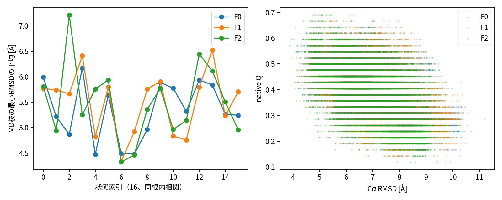
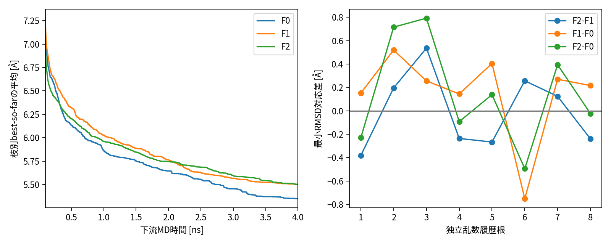

# P1-N1：既存B1のnative RMSD/Q限定CPU科学評価

2026-10-30 JST。**POST_HOC_EXPLORATORY / 計算交付と科学受入れを区別**。

## Executive Summary

既存32履歴・240下流、8乱数履歴根・16状態を変更せず、1FME model1の28CAに対するproper RMSDと固定native接触Qを評価した。全272単位、2,048,000 frameで入力SHA/座標/品質/時間の対応検査を通過した。新MD・学習・モデル推論・LOF・C/B2は0。下表は事後探索的な等MD量の対比であり、固定wall-clock純利益ではない。hit/dwellと第二Q、34NMR感度は実行していない。

主窓のF2−F1最小RMSD差はS4 +0.396619 Å、S8 −0.398921 Å、二状態平均 −0.001151 Å（探索区間[−0.204768,+0.216556]、8根の正負4/4）。S8−S4は−0.795541 Åだが時点・候補・M0の交絡を残し、CのX独立価値の証拠ではない。Qの平均差は二状態平均−0.003784で区間は0を跨ぐ。

## 1. 問い、事前規則と文献

目的は既存軌跡に天然構造への接近信号があるか、更新条件でその信号が変わるかを確認することである。[凍結実行カード](execution-approval.md)、[準備契約](../native-metric-contract.md)、[先行研究](../related-work-matrix.md)を参照。Bhowmikのensemble Qとは別定義である。今回の研究者承認はmodel1とQ_CA8_M1_G3_LTに限定される。旧B1/R1/Q0/L1/L2の結論を追認・書換えしない。

## 2. 入力・数学と単位

参照SHA a5276b2752cd95555f7ca078c512c68f89b50893519e99347a1986fa63c82dc8。等重み28CA、非周期Å座標、中心化後SO(3) proper Kabschによるr=sqrt(sum_i||Xc_i R−Nc_i||²/28) [Å]。R=U diag(1,1,det(UVᵀ)) Vᵀ、H=XcᵀNc=UΣVᵀ。鏡映・scale・末端除外なし。

Q=Σ_(i,j)∈C I[d_ij(X)<8Å]/|C|、C={i<j,j−i≥3,d_ij(N1)<8Å}。eligible325対中のnative接触は42対、分母固定、Q無次元[0,1]。全接触率の旧Q8とは異なる。自己参照r≈0/Q=1、鏡映の排除を[参照工程検査](reference-test.json)で確認した。

MDAnalysis2.9.0、NumPy1.26.4の既存環境を使用しDCD reader convert_units=True、Åのまま処理した。nmを暗黙に扱わない。原子文字列対応と既存CA配列の全点byte相当一致を確認した。DCD時刻はdt丸めを持つため、sim.csvと既存featuresの完全一致した原時刻を採用し、DCDとの最大差も保存した。

## 3. 統計単位、品質、全窓

F0各状態3本（共有）、F1/F2各2学習seed×3MDseed。独立単位は8乱数根であり、同根S4/S8、同モデル/MD seed、連続frameを独立根へ数えない。同一準備構造条件付きの乱数独立性で、独立蛋白質ではない。[全系譜](../branch-index.csv)。

既存valid=~reasons.anyを再利用し、原quality件数・time/CAと照合、品質条件を追加・緩和しない。0.5ps全保存点、各窓内最初の点から4点毎の2ps感度。burn 0/100/200/500ps×prefix1/2/4nsの全12窓。主表示4ns/100ps。2ns履歴の4ns窓はINCOMPLETE_WINDOWと明示し、完全4ns下流とは集約しない。burnは平衡証明でない。

条件内は等重み平均、F0を学習seedごとに重複させない。F2−F1等のS4/S8対応と平均・S8−S4を根ごとに保存した。bootstrap10000/seed17103001は8根再標本化の探索区間で、確認的p値を出さない。多数の相関尺度・窓から有利な結果を選ばない。

## 4. 全主要対比

rの差は負、Qの差は正が高いnative類似性に対応する。最小rの条件平均は枝別最小の平均で、全枝を連結した最小値ではない。

|指標|対比|段階|平均差|探索的95%区間|負/正/0 根数|
|---|---|---|---:|---|---|
|min_RMSD_A|F2-F1|S4|0.396619|[0.022389, 0.823959]|2/6/0|
|min_RMSD_A|F2-F1|S8|-0.398921|[-0.728974, -0.065673]|6/2/0|
|min_RMSD_A|F2-F1|AVERAGE|-0.001151|[-0.204768, 0.216556]|4/4/0|
|min_RMSD_A|F2-F1|S8_MINUS_S4|-0.795541|[-1.436161, -0.237645]|6/2/0|
|mean_RMSD_A|F2-F1|S4|0.161105|[-0.202410, 0.537880]|4/4/0|
|mean_RMSD_A|F2-F1|S8|-0.258517|[-0.612611, 0.078063]|5/3/0|
|mean_RMSD_A|F2-F1|AVERAGE|-0.048706|[-0.299664, 0.192615]|4/4/0|
|mean_RMSD_A|F2-F1|S8_MINUS_S4|-0.419623|[-0.938544, 0.095526]|5/3/0|
|mean_Q|F2-F1|S4|-0.017404|[-0.041019, 0.007241]|4/4/0|
|mean_Q|F2-F1|S8|0.009835|[-0.003747, 0.024945]|3/5/0|
|mean_Q|F2-F1|AVERAGE|-0.003784|[-0.014724, 0.006674]|5/3/0|
|mean_Q|F2-F1|S8_MINUS_S4|0.027239|[-0.006522, 0.060599]|3/5/0|
|min_RMSD_A|F1-F0|S4|0.057348|[-0.330661, 0.425692]|5/3/0|
|min_RMSD_A|F1-F0|S8|0.245735|[-0.028379, 0.469124]|1/7/0|
|min_RMSD_A|F1-F0|AVERAGE|0.151541|[-0.136309, 0.348740]|1/7/0|
|min_RMSD_A|F1-F0|S8_MINUS_S4|0.188386|[-0.230608, 0.565051]|3/5/0|
|mean_RMSD_A|F1-F0|S4|-0.204367|[-0.440479, -0.009390]|6/2/0|
|mean_RMSD_A|F1-F0|S8|0.292364|[0.038031, 0.585179]|2/6/0|
|mean_RMSD_A|F1-F0|AVERAGE|0.043998|[-0.174262, 0.234918]|2/6/0|
|mean_RMSD_A|F1-F0|S8_MINUS_S4|0.496732|[0.201835, 0.790022]|1/7/0|
|mean_Q|F1-F0|S4|-0.015407|[-0.041135, 0.011457]|5/3/0|
|mean_Q|F1-F0|S8|-0.020059|[-0.056752, 0.011208]|4/4/0|
|mean_Q|F1-F0|AVERAGE|-0.017733|[-0.036774, -0.000816]|6/2/0|
|mean_Q|F1-F0|S8_MINUS_S4|-0.004652|[-0.056905, 0.040575]|4/4/0|
|min_RMSD_A|F2-F0|S4|0.453968|[-0.139281, 1.129707]|3/5/0|
|min_RMSD_A|F2-F0|S8|-0.153187|[-0.418401, 0.076101]|6/2/0|
|min_RMSD_A|F2-F0|AVERAGE|0.150390|[-0.141620, 0.441953]|4/4/0|
|min_RMSD_A|F2-F0|S8_MINUS_S4|-0.607154|[-1.470365, 0.035226]|6/2/0|
|mean_RMSD_A|F2-F0|S4|-0.043262|[-0.531765, 0.394009]|4/4/0|
|mean_RMSD_A|F2-F0|S8|0.033847|[-0.145487, 0.269757]|4/4/0|
|mean_RMSD_A|F2-F0|AVERAGE|-0.004708|[-0.289214, 0.261986]|4/4/0|
|mean_RMSD_A|F2-F0|S8_MINUS_S4|0.077109|[-0.400867, 0.537111]|3/5/0|
|mean_Q|F2-F0|S4|-0.032811|[-0.058459, -0.008834]|7/1/0|
|mean_Q|F2-F0|S8|-0.010224|[-0.038464, 0.016946]|4/4/0|
|mean_Q|F2-F0|AVERAGE|-0.021517|[-0.040517, -0.004217]|6/2/0|
|mean_Q|F2-F0|S8_MINUS_S4|0.022587|[-0.015015, 0.061064]|3/5/0|

全9要約×24窓/間隔×3対比×4段階は[root-summary.csv](root-summary.csv)、各8根は[root-paired.csv](root-paired.csv)、16状態は[state-paired.csv](state-paired.csv)。CI跨0・符号不一致・Q/rの相反も隠さない。全モデル/MD条件は[model-windows.csv](model-windows.csv)、全枝・履歴は[all-windows.csv](all-windows.csv)。

共同分布図は全点の40点毎の固定表示間引きで密度の平衡分布ではない。全同frame(r,Q)/valid/time/IDはサーバの各frames.npzに保持。図のframe数を独立標本数としない。

## 5. 履歴進捗、旧幾何との関係

[history-progress.csv](history-progress.csv)は各決定時刻以前の共通履歴bestと各枝の4ns/100ps bestを対照し、gain=max(0,history_best−branch_best)とする。既知起点の再選択を新発見として誇張しない。ただし最小化/reseedと短期緩和、連続MDの違いは残る。

履歴bestを更新した枝はF0 22/48、F1 52/96、F2 47/96、gain平均は0.359558/0.319742/0.285500 Å。枝数は独立標本数ではなく、F0の標本数も異なる。4ns枝の最良値は全体3.614485 Åだがfolded認定閾値はない。有限時間のnative接近信号は存在する一方、更新の一貫した上乗せ利益は支持されない。[記述値](descriptive-facts.json)。

2ps感度でもF2−F1最小差はS4 +0.393358、S8 −0.397081、二状態平均−0.001861 Å。0.5/2psの方向はこの主窓で一致するが、全12窓を公開し、この一致だけを一般的頑健性と呼ばない。

旧R1四参照の全continuous表と、同窓0.5ps native値をbranch IDでjoinし、全適格frame数一致を確認した。[全join](geometry-native-joined.csv)、[全参照/窓/S4/S8相関](geometry-correlations.csv)。相関は依存branchの記述でp値を出さない。履歴から遠いことと天然へ近いことは異なる目的で、相関の有無だけで旧指標を正当化・棄却しない。

## 6. 費用と完全性

[費用](costs.json)：全単位wall 329.994523s、CPU 329.934963s、最大RSS 182.625MiB。summary wall 2.371534s、RSS 281.227MiB。出力 48696589bytes。SSH/import全過程を完全測定した値ではない。人工reader単独の秒数は未保持。最終保存監査の実時間/CPU/RSSはfinal-server-audit.jsonに別記し、元単位費用へ加算して書換えない。首単位は[first-unit-gate.json](first-unit-gate.json)。科学2h/RSS2GiB/出力2GiBに達しなかった。

[全単位監査](unit-audit.json)に原DCD/PDB/csv/features/quality/resultの前後SHA、全frame件数、CA逐点一致、reader時間差、出力SHAと実時間を保存した。原archive9個は保持し、Mac原archive転送なし。最終compact転送/ソース/旧証拠の検証を[最終監査](delivery-audit.json)へ記録する。単位receiptで成功出力を検証後、既存成功単位は再実行しなかった。

人工readerは9チェックPASS。欠損ファイルを意図的に開く負試験では、期待した例外に加えてMDAnalysis2.9.0のdestructorが`DCDReader has no attribute _file`をstderrへ出した。人工の欠損試験に限る既存readerの後始末警告で、実272読み取りは成功した。非周期人工DCDのzero unitcell警告、今後3.0でのtimestep挙動変更のDeprecationWarningも記録する。警告を消すために実入力や旧品質を変更していない。科学単位の失敗/再試行0。[欠損・警告](failures-and-missing.json)。即時stdoutの全量は端末会話にあり、永続監査は全単位receiptを用いる。

## 7. 陰性、不確実性、Threats to Validity

天然RMSDはglobal構造類似性、Qは固定接触回復であり、正しい折り畳み、熱力学安定性、population・kineticsを認定しない。GBn2/NoCutoff、unfolded準備/質子化履歴、初期平衡、reseedの物理的資格は旧未解決のままである。CVAEのL1/L2表現・seed/KL問題も今回解決していない。

B1を見た後に採択したnative評価は事後探索。8既知根を未知確認として扱わず、現標本に適合する閾値を導入しない。初期条件/候補pool/M0/時点/履歴参照の混雑を除去した新介入ではない。frameは強く時間相関し、偶然の最小値はsampling密度と観測時間に依存する。0.5/2psを全条件で公開した。float32 DCD・PDBの量子化とSVDの有限精度を含み、厳密な生物学的誤差幅は未同定。34NMRは別予算未承認で、model1依存を定量的に否定できない。

## 8. C/B2への判断と停止

**現時点の回答**：4nsで測定可能なnative接近信号はある。ただし「資源受限方策の差を識別するのに十分か」は未確認で、更新全体差がほぼ0かつQも一貫せず、600秒を十分な確認予算とは認定しない。

この評価から判断できるのは現在の物理条件・4ns枝におけるnative信号の範囲と条件差である。固定wall-clockの利益、XのZ/W超過価値は識別できない。将来H600秒案が十分かは、MD長と実GPU cost、モデル更新コスト、独立根の進捗分散を別承認の資格測定で確認する必要がある。既報52秒/nsからの外挿は概算で、今回のCPU費用はGPU費用ではない。

信号が小さい・更新差が不確実なら、閾値を緩めて成功とせず、時間尺度/科学資格/成果定義を研究者と検討する。信号があってもC/B2を自動批准しない。今回の技術段階は全件整合ならPASS、科学受入れ/独立審査PENDING。次は研究者とChatGPTの独立審査のみ。

## 9. 再現

ソース[n1_cpu_evaluate.py](../../../p1/n1_cpu_evaluate.py)、[集計](../../../p1/n1_cpu_summarize.py)、[人工reader test](../../../p1/n1_reader_test.py)、[純粋関数](../../../p1/n1_native_metrics.py)。実行カード版b5fd110、集計/人工reader版3aa930b、最終版はGit履歴/回読記録参照。既存環境でCUDA_VISIBLE_DEVICES=-1、OMP/MKL/OPENBLAS/NUMEXPR_NUM_THREADS=1、PYTHONDONTWRITEBYTECODE=1を設定し、独立出力でevaluate --phase first→gate確認→--phase full→summarizeの順。本人許可領域と占有確認が必須。原入力・成功出力は上書きしない。GitHubはcompact表/図/監査/ソース、全frame配列は許可サーバのみ。
