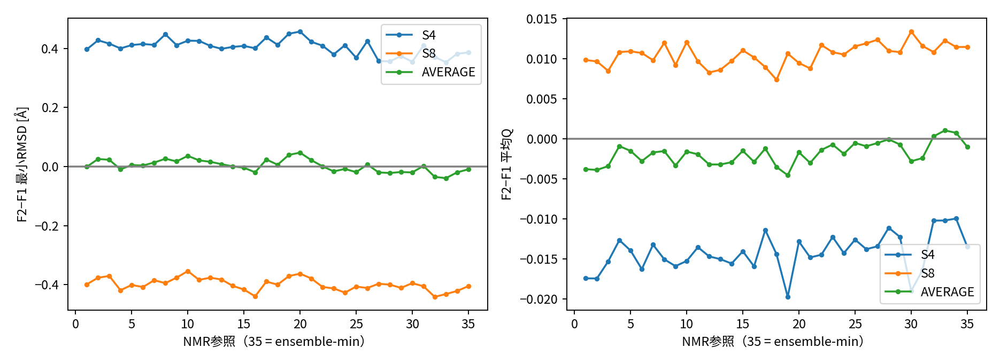

# P1-NMR34-FULL：全272既存軌跡の天然参照感度

2026-10-31 JST。基準33f6aa9e5071af18d7b841b61367507d2113b834、実行凍結7c24237117c17d2d6c1a629b3ece9ea3529be978。**計算272/272完了・数値/入力/成果監査PASS、独立科学審査と研究者科学受入れPENDING**。全科学解釈は **POST_HOC_EXPLORATORY**。

## Executive Summary

主質問への回答は、**事前固定した主窓における「F2はS4で遠く、S8で近い」という最小native RMSDの平均方向は、1FMEの34固定NMR参照すべてで保持された**、である。S4のF2−F1は+0.352999〜+0.456842 Å、S8は−0.441402〜−0.354038 Å。残りの23窓/間隔条件でも同じ平均方向が全34参照に保たれた。これは独立34回の再現実験ではなく、同じデータの参照感度である。

一方、二状態平均の最小RMSD差は参照間で−0.039509〜+0.046956 Å、34参照すべての8根bootstrap探索区間が0を跨ぐ。平均Qの二状態平均も34参照すべての区間が0を跨ぐ。普遍的更新優位、CにおけるX独立情報価値、B2のwall-clock純利益を示さない。候補pool/M0/訓練window/段階履歴の交絡は残る。

科学計算・集計の外部監視wall711.018秒、成果監査を加え713.663秒（約11.89分）。新出力約1.225GB、監視process-tree RSS最大297.375MiB。計算失敗・再試行・保護停止0。数値thread設定は1、OS process threadの観測最大は2で、描画用font cache Timerに整合する固定sourceを確認したが当該thread IDの直接帰属ログはない。この区別を資源審査に残す。

## 1. 目的・承認・対象

研究者は本チャットで全272既存軌跡のCPU再評価と、科学累計7200秒/工程300秒/RSS2GiB/新出力2GiBを明示承認した。[事前計画](analysis-plan.md)、[固定manifest](manifest.json)、[設定](config.json)。新MD、CVAE訓練/推論、LOF、R0、C/B2は0。

対象はFSD-EY/1FME、32履歴＋240下流、8履歴根、16状態、F0/F1/F2の原seedと親モデル関係。総2,048,000frame×34＝69,632,000 frame-reference組。元N1/V2資格と同じ物理軌跡を使い、天然構造の参照だけを変えた。MD物理モデルや学習recipeの再資格を本作業で認定しない。

工程16人工test methodsは対象サーバの既存環境でPASS。[全ログ](artificial-tests.log)。実入力処理前に9ファイルのコード/manifest/config/計画をGitHubへ送り全文照合した。[工程回読](engineering-readback.json)。

## 2. 原入力と実行環境

全2448ファイル（各単位7原科学ファイル＋旧N1のframe/window出力）を最初に実SHA照合し、各単位後と最終にも不変性を検査した。固定参照PDB2個と集計用旧geometry/N1根要約もSHA固定。全task ID、8根、状態、学習seed、MDseed、模型祖先はmanifestから追跡できる。旧N1/B1/R1/Q0/L1/L2/NMR34-QA/v2資格のデータと結果を変更しない。

既存Python3.12.3/NumPy1.26.4/MDAnalysis2.9.0、CPU Intel Xeon w7-3565X（同サーバの[既存hardware記録](../P1-NMR34-v2/qualification/hardware.json)）、Matplotlib3.10.1。GPU不可視、科学worker1、数値thread環境1。新規インストール/共有設定変更なし。起動直前にusers/process/CPU/RAM/GPU/ディスクをread-only確認、約116GiB RAMと821GiB diskが利用可能だった。他者のprocessを停止せず、許可されたCPU範囲だけを使った。新規予約表の取得は行っていない。

独立[全量実行器](../../p1/nmr34_full.py)はproject領域global lock、外部監視、fsync追記budget、不可変成功receipt、全stdout/stderrを保持する。自動再起動しない。明示resume承認、同じfingerprintと確定台帳が必要で、成功成果はSHA確認後のみskipする。部分成果は承認付きで別attemptに保全する。[再現・復旧境界](reproduce.md)。今回の復旧実行は0。

## 3. 固定指標と窓

28 Cαの順序対応、非周期Å、等重みproper Kabsch（SO(3)、反射禁止）を用いる。

\[
r_k(x)=\min_{R\in SO(3)}\sqrt{\frac1{28}\sum_i\|(x_i-\bar x)R-(N_{k,i}-\bar N_k)\|^2}.
\]

\[
C_k=\{(i,j):i<j,\ j-i\ge3,\ d_{ij}(N_k)<8\mathrm{Å}\},\quad
Q_k(x)=|C_k|^{-1}\sum_{C_k}\mathbf1[d_{ij}(x)<8\mathrm{Å}].
\]

model1が主系列、34モデルは感度系列。min34(x)=min_k r_k(x)、k*(x)は同値で小番号、対応QはQ_k*(x)。参照別C_k/分母は異なり、min34のQを固定C1に対するQと同義にしない。[参照対応](reference-map.json)、[定義の継承元](../P1-N1-Review/nmr34-contract.md)。hit/dwell/第二Qやfolding成功閾値を導入しない。

4 burn条件0/100/200/500ps×3 prefix条件1/2/4ns×2 sampling間隔0.5/2ps＝24条件を保持。元時刻比較→窓内stride→元qualityの順序。主窓は4ns/100ps/0.5ps。200/500psの既報1点差は丸めず、不完全な履歴4ns窓のstatusもそのまま保存した。

単位ごとにCAを一度cache、34参照中心化/mask固定、512frame chunkでbatch計算。normal modeでは全点scalarを繰り返さず、各軌跡の0/floor(N/2)/N−1を事前指定して全34参照を照合した（816frame、27,744組）。全frame M1と旧N1、Q1整数count、原ID/時刻/quality/全窓を別に照合する。

## 4. 統計階層と全出力

F0は共有3MDseed、F1/F2は各2学習seed×3MDseed。各学習seedのMD平均から状態臂平均を作り、F0を複製しない。8根内でF2−F1/F1−F0/F2−F0、S4/S8/二状態平均/S8−S4を作る。9原指標を等しく保持し、frame/参照を独立標本にしない。

原N1と同じseed17103001/10,000 root bootstrap drawsを全参照へ共有。95%探索区間であって多重比較を調整した確認的区間ではない。詳細は[集計契約](analysis-methods.md)。

全35系列の出力は、枝/履歴228,480窓行、状態40,320行、学習モデル67,200行、根対応80,640行、指標別根要約90,720行。`results/1`〜`results/34`と`results/NMR34_MIN`に全系列を同じ構造で保存した。有利な参照や窓を選別していない。

## 5. 主質問：参照感度の数値

主窓F2−F1最小RMSDの平均 [Å]。正はF2が遠い、負は近い。

|段階|model1|min34|34固定参照の範囲|平均の符号|
|---|---:|---:|---:|---|
|S4|+0.396619|+0.386003|+0.352999〜+0.456842|34/34正|
|S8|−0.398921|−0.405062|−0.441402〜−0.354038|34/34負|
|二状態平均|−0.001151|−0.009529|−0.039509〜+0.046956|20正/14負|
|S8−S4|−0.795541|−0.791065|−0.842465〜−0.749708|34/34負|

[全主窓・全対比](results/main-reference-sensitivity.csv)、[整理JSON](scientific-summary.json)。S4は24/34参照の探索区間が0より上、10/34は0を跨ぐ。S8と交互差は34/34で区間が0より下。二状態平均は34/34で区間が0を跨ぐ。34区間の数を独立試験の成功率とは呼ばない。

model1の探索区間はS4 [+0.022389,+0.823959]、S8 [−0.728974,−0.065673]、平均 [−0.204768,+0.216556]、交互差 [−1.436161,−0.237645]。min34ではそれぞれ[+0.035604,+0.795467]、[−0.718945,−0.104935]、[−0.183040,+0.173253]、[−1.424579,−0.247093]。

**DERIVEDな限定結論**：model1だけの選択で主窓の平均方向が生じたという説明は、この34構造族では支持されにくい。min34でも同じ段階方向が残る。総合平均の利益は小さく不確実であり、参照によって符号も変わる。

### 根ごとの不均一性

model1の主窓F2−F1 [Å]。

|根|S4|S8|平均|S8−S4|
|---|---:|---:|---:|---:|
|r01|+0.039076|−0.801915|−0.381419|−0.840991|
|r02|+1.554726|−1.162875|+0.195926|−2.717602|
|r03|+0.933418|+0.139738|+0.536578|−0.793680|
|r04|−0.015344|−0.456939|−0.236141|−0.441595|
|r05|−0.397005|−0.136285|−0.266645|+0.260720|
|r06|+0.128945|+0.385077|+0.257011|+0.256132|
|r07|+0.656168|−0.407542|+0.124313|−1.063710|
|r08|+0.272969|−0.750631|−0.238831|−1.023600|

[全model1根表](results/1/root-paired.csv)、[全min34根表](results/NMR34_MIN/root-paired.csv)。平均方向は各根すべてに成立する法則ではない。model1のS4は6根正/2負、S8は2正/6負。min34のS4は5正/3負となり、r06の個別方向が変わる。集約平均の参照頑健性と個別履歴の予測可能性を区別する。

## 6. Q・他対比・全窓・幾何

主窓F2−F1平均Qの固定参照範囲はS4 −0.019710〜−0.009940、S8 +0.007369〜+0.013387。点方向は34/34でRMSDの段階パターンに対応するが、S4/S8とも平均Qの全探索区間が0を跨ぐ。二状態平均は−0.004536〜+0.001048、31参照で負/3で正、全区間が0を跨ぐ。最小RMSDの結論をQの確定的優位へ置換しない。

主窓最小RMSDの他対比も保持する。

|対比/段階|model1 [Å]|34固定参照の範囲 [Å]|
|---|---:|---:|
|F1−F0 S4|+0.057348|−0.019902〜+0.161760|
|F1−F0 S8|+0.245735|+0.218957〜+0.299294|
|F1−F0 平均|+0.151541|+0.111573〜+0.224713|
|F2−F0 S4|+0.453968|+0.406118〜+0.561994|
|F2−F0 S8|−0.153187|−0.187066〜−0.112371|
|F2−F0 平均|+0.150390|+0.127678〜+0.211667|

これらは点推定であり、正負だけで有意性を宣言しない。全根・全指標の区間は各参照のroot-summary.csvに収録した。F2がF1より良い段階があっても、F0に対する全体利益を意味しない。

[全24条件の方向表](window-sensitivity.csv)では、F2−F1最小RMSDのS4正/S8負が全固定参照に保持された。重複windowと部分集合samplingは独立反復ではなく、同じ元履歴に対する感度である。全9指標の区間/値も全て保存した。

旧幾何との主窓absolute endpoint Spearmanの例：最小RMSDはORIGINAL_HISTORYで−0.2000〜+0.0275、COMMON_A4で−0.1632〜+0.0395、COMMON_A2で+0.0343〜+0.2690。mean QはCOMMON_A2で−0.4933〜−0.4002、他集合では概ね−0.23〜−0.13。参照集合による違いがあり、幾何新規性をnative進展や更新効果の単純代理としない。[model1全相関](results/1/geometry-correlations.csv)、各参照に同じ全4集合/12窓の相関表。相関branchのp値は出していない。

## 7. 数値・資源・保存監査

[成果監査](delivery-audit.json)で272成功receipt、全成功出力SHA、6,568ファイルのbyte索引、原9archive存在/サイズを確認。入力SHA前後不変、全M1 frame最大誤差8.88178e−15 Å、固定scalar抽査最大7.10543e−15 Å、Q1 count完全一致。[M1根級再現](results/M1-root-reproduction.json)：2,592行の統計最大差5.32907e−15。原200/500ps結果を変更していない。

[外部監視](supervisor.json)：科学711.018489秒、全単位wall合計641.496947秒/CPU641.449572秒、統計wall45.214936秒/CPU45.185347秒。起動/全入力SHA/参照/その他管理を含む差は別費用で、重複して加算しない。成果監査2.644697秒を永続budgetへ加え、累計713.663186秒。監視peak RSS311,820,288 bytes（297.375MiB）、監査processは約51MiB。出力1,225,163,390 bytes（約1.141GiB、audit receipt自身を除くsnapshot）。上限未達。

near±1e−6Åの記録は100件。近傍pairの削除・幅変更・モデル削減をせず、rawchunk内のpair/marginを保持した。数値丸めによる接触定義変更はない。34参照への所属はreference-mapから追跡できる。

**thread監査の留保**：数値thread環境は1だがOS worker thread観測最大は2。[固定ソフトウェア証拠](software-evidence.json)でMatplotlib3.10.1 font_managerのTimer生成を確認、新processのOpenBLAS poolも各1threadだった。描画初回font cache Timerという説明に整合するが、元workerの各thread ID/CPU時間ログはないので厳密な帰属はUNVERIFIED。OS thread数2を隠して「全processが常時1thread」とは記載しない。CPU affinity/共有設定は変更していない。0.2秒監視も瞬間ピーク保証ではない。

科学失敗0、再試行0、保護停止0。既存MDAnalysisのDCDReader timestep-copy非推奨警告をraw stderrへ完全保存。raw stdout/stderr/全budgetログ/ID配列/逐frame chunkは許可サーバに保全し、内部パスを含む原ログはGitHub本文に転記しない。元9archiveは存在/サイズ一致、本輪の全archive再hashではない。Mac raw全量backup免除を維持。コード・compact完全表・図・全SHA/出典をGitHubへ送り、実際の遠隔回読で技術交付を閉じる。

## 8. Threats to Validity と主張の境界

参照モデルは同じ1FME NMR構造族であり、別native ensemble/別タンパク質/溶媒条件に一般化しない。8根は同じ対象の乱数履歴で、生物学的独立対象8個ではない。frameの時間相関、重複窓、34参照の依存、多重指標、探索的bootstrapの制限を維持する。

S4/S8では候補pool、M0、訓練window、歴史長が同時に変わる。参照感度を弱めても、段階差を科学フィードバックXだけの因果効果とできない。旧MDの準備/平衡/短時間reseed、CVAE表現資格の問題は本計算で解決しない。

min34の絶対RMSD低下は数学的選択効果であり、方策改善ではない。Qの分母とargmin条件付けも異なる。既存データの事後分析で、未知根確認・C予測器・固定wall-clock B2実験を代替しない。教師なしの候補選択が科学的に有効であるという新主張も行わない。

## 9. 判定と停止

数値再現・入力/成果完全性・wall/RSS/disk門はPASS。全272と全統計が完了。threadの詳細帰属は留保し、独立科学審査/研究者科学受入れはPENDING。

次は研究者指定の **Astra Extra Highによる独立科学審査**。参照頑健性が解消した説明と、残る交絡/全体利益不足を審査する。本作業から新MD、CVAE、LOF、R0、C/B2へ進まない。GitHub全文回読後停止する。
