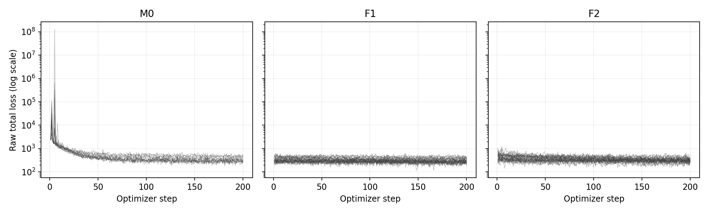
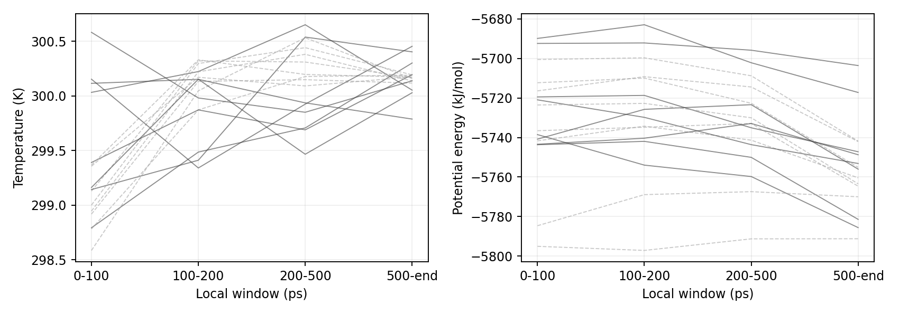

# Q0：既存CVAE・MDログの資格監査報告

2026-10-29 JST。研究者承認の限定CPUログ監査。基準3b8b7b25da85c5d5da055b093ee4c79f6ff850b7、計画・初版実装9c360a9aa2fb92c4e15534789b8b74ddbebc9f42。科学生成版40a911eとは区別する。

## Executive Summary

**ログ上の実行完全性は確認できたが、CVAEの学習十分性とMDの物理的適用範囲は引き続きUNVERIFIEDである。** 80モデル、272 MD、2,048,000行のMDログを読み、主入力1,328ファイルを旧SHAと照合した。追加の原品質記録と公開品質表も照合した。新しいMD、モデルload・訓練・推論、LOF fit、DCD読取り、構造成果の再評価は行っていない。

重要な負の所見はr07-s4-M0の単歩total loss最大130,942,008である。有限値ではあるが、平均値と末尾低下だけで安定した学習を認定できない。各モデルは一回200歩で、継続するvalidation曲線も保存されていない。温度平均は約300Kでも、勢能の初期区間と後半には差があり、平衡化時間を認定しない。

## 1. 問い・範囲・証拠分類

CONFIRMEDはQ0の実行範囲。MEASUREDは保存ファイルの実読取り・SHA/計数、DERIVEDはログの記述量、UNVERIFIEDは学習収束・準備妥当性・平衡・科学的有用性。独立科学審査/研究者受入れはPENDING。[事前計画](analysis-plan.md)、[前段資格審査](../P1-Post-R1-Qualification/qualification-review.md)。

Q0は「記録された処理がどの程度追跡でき、どの科学資格が欠けるか」を問う。CVAEが最良か、更新が構象被覆を増やすか、XがZ/Wを越えるか、固定wall-clock純利益が正かは評価しない。

## 2. 入力・実行環境・資源

許可サーバの既存B1 runとsummary-v1、公開raw SHA索引、models/task manifestを使用した。Python3.12.3、Linux、標準ライブラリによる監査、図は既存環境のMatplotlib3.10.1。OpenMM/Torch/mdlearnの新実行・インストールなし。旧実験のOpenMM8.5.2、Torch2.7.1+cu128等は[B1環境](../P1-B1-Expansion/handoff-to-chatgpt.md)を参照する。

接続時・CPU処理開始前に共有CPU/メモリ/GPUを読取確認した。負荷平均は0.06–0.19程度、空き利用可能RAM約119GB、GPU計算なし。私的ユーザー一覧を公開していない。GPU不可視、CPU affinity1、数値thread1、nice10、追加RAM上限2GiB。新出力は本人領域の独立Q0ディレクトリ。2時間復核点に到達していない。

## 3. 80モデルの完全性と系譜

M0が16、F1/F2が各32。全80でrequest seed、resultの初期/最終model・optimizer・RNG digest、親checkpoint SHA、実checkpointバイト、recipe、exposure、lossを照合した。全て200 optimizer steps、相異なる800フレーム、batch4。permutationが0…799の全単射で、記録されたframe ID順と索引の順が一致した。validation200点とのID非重複を確認した。[モデル系譜](model-lineage.csv)、[全64,000提示ID](model-exposures.csv)、[全recipe](model-recipes.json)。

F1/F2の各対応学習block32組で親、初期model、optimizer、RNG digestおよびseedが一致した。M0は初期化seed1600000001、更新seedは旧固定規則を保持した。optimizerはRMSprop、lr0.001、weight decay0.00001。[凍結科学関数](../../p1/server/b1_science.py)。

これは記録digestとファイルバイトの照合であり、重みをloadしてoptimizerテンソルや保存RNGを再計算した新検証ではない。時間合法性もID非重複だけで全て認定せず、[旧時間/SHA監査](../执行证据/2026-10-26-b1-expansion/temporal-and-SHA-audit.json)と固定時間splitを併読する。旧側validationは新側の未知データ汎化を保証しない。

## 4. lossの計量と曲線

各loss.jsonはper_stepにtotalだけを200個、mean_lossにtotal/BCE/KLの三つのbatch平均、validation_lossに末尾検証の三平均を保存していた。逐歩BCE/KLはNOT_SAVED、逐歩validationもNOT_SAVED。これらをtotalから逆算しない。[16,000逐歩値](model-loss-per-step.csv)、[80モデル完全表](model-loss-summary.csv)。

固定mdlearnはBCEをbatch×28×28でsum、KLをlatent方向sum・batch方向meanとする。λrec=1。R_iを一枚の全784要素のBCE、K_iを一枚のKLとして、batch Bのtotalは ΣR_i + (ΣK_i)/|B|。trainは200 batch×4、validationは64/64/64/8の4 batchで、最終報告はbatchの平均である。

したがってtrain BCE/枚=記録BCE/4、validation BCE/枚=記録BCE×4/200=記録BCE/50。更に784で割った要素当たり列も独立保存した。対称/対角要素を含む全要素の診断で、長距離接触再構成の資格とは異なる。KLは同じ割り算をしない。validationのsample重み付きKLは、batch別値がないため回復できない。生のtotalと記録値は変更していない。

訓練はdropout/確率的潜在sample、validationはevalのmuを使用する。尺度を揃えてもtrain/validationのモード・データ・時点が異なるため、大小から単純に過学習を判定しない。

|臂|モデル数|末尾20歩平均が冒頭20歩平均より低い|train BCE/枚|validation BCE/枚|train KL batch平均|
|---|---:|---:|---:|---:|---:|
|M0|16|16/16|144.017772|109.685296|41351.079995|
|F1|32|31/32|78.485656|101.215808|5.079326|
|F2|32|32/32|87.752448|85.424775|5.176126|

数値は臂内のモデル平均の記述であり、独立モデル80本の母平均推定ではない。末尾対冒頭の20歩平均は資格診断用の表示窓であり、事前登録された科学効果検定ではない。F1のr02-s4-F1-t1では末尾が冒頭より低くなかった。16/16・31/32・32/32の低下を「全て収束」と言い換えない。

r07-s4-M0は単歩total最大130,942,008、M0のtrain KL batch平均のモデル最大は654,412.987045。各量は別の集約であり、未保存の当該step KLを特定したとは言わない。極端値を除外せず、全M0曲線と生値を残す。単一epochの末尾validationしかなく、plateau、潜在崩壊、長距離接触の非自明再構成、別根汎化は未判定。今後のL審査で、学習曲線と保持データ診断を検討すべき根拠になるが、新訓練は承認されていない。

## 5. 272 MDの時間・品質・早期変化

履歴32×2ns=128,000行、下流240×4ns=1,920,000行、計2,048,000行。ログ間隔0.5ps/250stepsを確認し、全数値は有限。各区間の開始+0.5ps、終了とresult時刻が一致し、履歴の24接続でcheckpoint時刻が連続した。[全task](md-task-diagnostics.csv)、[24接続](history-continuity.csv)。タイミングの1e−5ps許容は浮動小数点丸めの点検用で、物理的平衡閾値ではない。

履歴はcheckpoint継続であり、各2ns境界を新しい独立緩和実験と見なさない。下流は座標再最小化・速度reseedで、連続の位相空間軌道ではない。[登録窓の全1,088行](md-window-diagnostics.csv)と[10ps表示系列](md-timeseries-10ps.csv)を公開する。窓の分類は検証済み報告indexの公称0.5psを用い、境界重複を避ける。

履歴task平均温度299.610683–300.696067K、下流299.549310–300.922948K。温度平均は温調の限定診断である。勢能の単位はkJ/mol、観測値の有限性・時間変化を調べたが、Langevinのtotal energyを保存エネルギーと仮定していない。異なる根・起点の勢能絶対値は探索価値や自由エネルギーの順位ではない。

|根|種類|task数|平均温度 K|平均勢能 kJ/mol|0–100ps勢能|500ps以後勢能|
|---|---|---:|---:|---:|---:|---:|
|r01|history|4|300.151|-5711.883|-5689.862|-5717.221|
|r01|downstream|30|300.156|-5750.482|-5712.295|-5755.114|
|r02|history|4|300.096|-5701.299|-5692.404|-5703.594|
|r02|downstream|30|300.090|-5738.536|-5716.414|-5742.072|
|r03|history|4|300.311|-5742.587|-5719.462|-5747.219|
|r03|downstream|30|300.145|-5757.863|-5741.694|-5760.413|
|r04|history|4|299.845|-5777.797|-5738.541|-5785.608|
|r04|downstream|30|300.146|-5791.489|-5795.073|-5791.241|
|r05|history|4|300.063|-5772.868|-5743.667|-5781.439|
|r05|downstream|30|300.158|-5770.148|-5784.650|-5770.003|
|r06|history|4|300.304|-5748.952|-5720.949|-5753.160|
|r06|downstream|30|300.128|-5760.817|-5736.574|-5764.642|
|r07|history|4|300.110|-5748.856|-5740.830|-5756.022|
|r07|downstream|30|300.148|-5758.934|-5723.552|-5763.457|
|r08|history|4|299.908|-5745.676|-5743.428|-5748.734|
|r08|downstream|30|300.184|-5737.264|-5700.536|-5741.829|

上表は各根内のtask平均を等重みで記述したもの。historyは四segment（局所窓はsegment起点基準）、downstreamはS4/S8・全臂を含む30枝。S4/S8や臂の因果差を推定する表ではない。詳細なtask/window値を保持し、根間の差を相関フレーム数で有意化しない。例えばr01下流の0–100ps平均勢能−5712.295に対して500ps以後−5755.114であり、温度が近くても構造・エネルギー緩和は同義でない。これを全根の平衡時間の決定根拠にはしない。

履歴32の既存品質記録は各4000点のvalidを保持し、下流240の旧品質表も照合した。[履歴品質](history-existing-quality.csv)、[下流品質](existing-quality.csv)、[追加SHA監査](supplemental-input-audit.json)。これは過去の幾何検査結果の読戻しであり、DCDから再検査していない。温度安定・全有限・粗品質合格から、全構象空間の平衡、力場妥当性、100ps burn-in十分性を認定しない。

## 6. unfolded・水素・端基・準備履歴

[今回の入力inventory](preparation-inventory.json)は固定unfolded SHA8cb0382cb19e24c1159eb672b236bc1a6642fc8025e6c5cb8200c3c4c435d2b3、28残基504原子253H、水残基0を確認した。GBn2の暗黙溶媒なので、明示水がないことだけを欠陥とはしない。先頭GluにはHT1/HT2/HT3、末尾ArgにはOT1/OT2という原子名がある。名前にないH1/OXTを探した限定列terminal_atom_namesは空だが、全末端原子名の別列を併記した。空欄を「端基なし」と解釈しない。

原子名と力場への対応、既報の約+4eは、指定pHや正しいプロトン化を証明しない。上流DeepDriveMD commit b18dacba46f079644e4ee66191675375581955c3と取得URLは[入力manifest](../../inputs/p1-fsd-ey/manifest.json)。unfolded生成・熱処理・水素付加コマンド・端基選択理由・独立初期平衡の完全な記録は今回得られなかった。pH、準備コマンドはUNVERIFIED。

|事項|証拠と現状|影響|
|---|---|---|
|構造同一性|固定上流URL/SHAと今回PDB一致|入力を再指定できる|
|水素/水/端基名|上記inventoryと全末端名|記載内容の確認。化学妥当性の認定ではない|
|pH/プロトン化/熱展开|準備史が未取得|物理系の解釈・初期集団への外挿に制限|
|GBn2/NoCutoff|既報固定ソースと結果system記録|同近似モデル内の限定比較|
|局所緩和|既存log窓とreseed履歴|十分性を示す独立資格なし|

物理背景と原著/固定OpenMM版の索引は[前段一次資料索引](../P1-Post-R1-Qualification/evidence-and-sources.md)、[準備史/截断監査](../P1-S2-supplement/science-readiness.md)。今回新たな文献発見や領域教員の承認を主張しない。NMR条件をMDのpHへ転用しない。

## 7. 失敗・修正・不確実性

[failures.json](failures.json)に初回読取パスの誤りと、最初のQ0窓分類の浮動小数点境界問題を記録した。100ps等を微小に越えた時刻が隣接窓に二重に入る可能性を見つけ、公称report indexで排他的に分類し、全taskの窓行数総和が元行数に一致することを追加点検した。旧Q0出力/旧スクリプトはサーバのoutput-before-boundary-fixと版付きcodeに保持。B1/R1を修正したのではない。公開窓/根表は修正版のみで、旧Q0版は科学結論に使わない。

未保存：逐歩BCE/KL、逐歩validation、正確なsample重み付きvalidation KL。未取得：準備の完全な履歴。未実施：モデルload、新保持block評価、収束/表現/平衡/構造被覆の認定。80モデルは16状態に入れ子、MDは8根に入れ子。記述平均に独立標本の検定/CIを付けていない。step比較は進む重み・batchの難易度も異なる。

## 8. 費用と保存

修正版主監査wall9.791941s/CPU9.789135s、峰RSS84.258MiB。[主費用](costs.json)。追加照合wall0.134807s/CPU0.134166s、図処理wall0.650427s/CPU0.649804s、図処理峰RSS91.051MiB。[補助費用](supplemental-costs.json)、[図費用](figure-costs.json)。修正前主監査wall9.851703s/CPU9.848737sも[前pass費用](prior-pass-costs.json)に残す。

一つの中間summary再実行の費用が上書きされて正確な値を保持しておらず、全プロセス累積の精密総計はUNVERIFIED。図のimport、SSH、圧縮、転送、文書作成も上の区間外。これらを含む総wallを約10秒と呼ばない。資源復核の2時間に達しない短い監査で終了し、追加科学計算を開始しない。記録された峰RSSは2GiB内、出力は数十MiB未満で1GiB内。

9原archiveは存在・サイズと旧manifestが一致したが、Q0で20GB全体のSHA再読取りはしていない。既報R1の全SHA確認と区別する。削除/移動/再圧縮なし、Mac raw backupはWAIVED_BY_RESEARCHER。Macへ取得したのはQ0派生表/図だけ。[全主入力SHA](input-sha256.csv)、[派生出力SHA](output-sha256.json)を参照する。

## 9. 判定と研究者への引継ぎ

|項目|判定|支持される範囲|
|---|---|---|
|Q0ログ実行完全性|技術PASS|80モデル/272 MDの指定記録・SHA・時刻・IDを追跡|
|学習十分性|UNVERIFIED|有限実行と曲線低下のみ。尖峰・一回検証・表現品質不足|
|物理適用性/平衡|UNVERIFIED|数値・温調・旧粗品質の限定診断|
|探索改善/C/B2|NOT TESTED|Q0では新成果評価をしていない|
|次の計算|NOT APPROVED|P/L/O、C、B2、S3は別審査|

推奨は、研究者/ChatGPTがr07-s4-M0尖峰と不足するvalidationを含めL資格の必要最小項目を先に判断し、領域教員にはpH/端基/起始準備の必要条件を確認すること。Q0を理由に全配方を作り直さず、現レシピの限定主張を残せるかも判断する。新計算の規模・閾値・成果定義を実装者が確定しない。

完全引継ぎは[handoff-to-chatgpt.md](handoff-to-chatgpt.md)。交付・GitHub回読後停止する。
