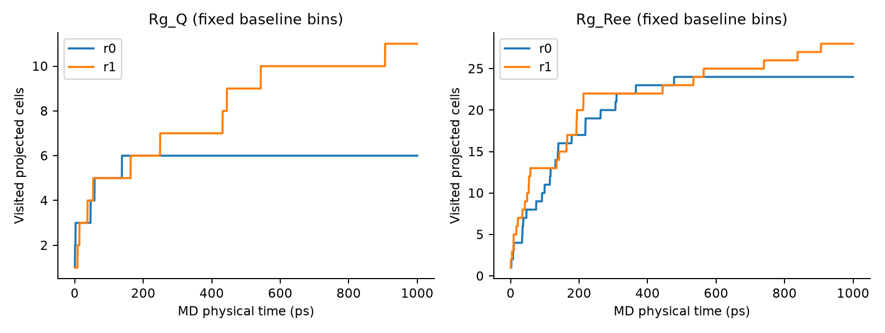

# A：固定物理投影与独立结构中心库

2026-10-25 JST。状态：`DERIVED / 内部检验`；指标与阈值仅为 `PROPOSED`，没有冻结为正式论文评价器。来源：[事前计划](analysis-plan.md) §2–5；执行代码 `656df0cf2677affaf362ed631b662545321f80e3`。

## 数学定义、物理意义与阈值

对按序列排列的28个Cα坐标 x_i∈R³（Å），定义等权质心 x̄=(1/28)Σx_i，R_g,CA=√[(1/28)Σ||x_i−x̄||²] Å，反映整体空间尺度；不是全原子质量加权回转半径。R_ee=||x_28−x_1|| Å，描述末端分离。

长程对集合 P₄={(i,j):j−i≥4}，共300对。Q_long(r)=(1/300)Σ_(i,j)∈P₄ 1[||x_i−x_j||<r]，无量纲；它衡量接触紧密程度，不引用天然结构，不是 native-contact Q。全部计算采用非周期欧氏距离，不应用PDB盒子的最小镜像。

对物理特征 (u,v) 的固定格子 g=(floor((u−o_u)/w_u), floor((v−o_v)/w_v))，U_n=|{g_1,…,g_n}| 是访问的投影格子数。没有有限全空间分母；U不能写成“总构象空间覆盖百分比”或亚稳态个数。无截断上界，超出观察范围仍按同一网格计数；Q=1计入有效格子。Q采用整数接触数/300的有理数分箱，避免浮点0.15/0.05意外落入相邻格。

事先网格：r=7/8/9Å；Rg箱宽0.5/1/2Å；Q箱宽0.02/0.05/0.10；替代Rg×Ree的Ree箱宽1/2/4Å；原点(0,0)或两轴均半箱宽。每条轨迹54组Rg×Q+18组Rg×Ree，共72组；6条轨迹432行，主分析2条最长轨迹144行。展示基线为Rg1Å/Q0.05/r8Å或Rg1Å/Ree2Å、零原点，事前确定而非从结果挑选。尺度是内部物理分辨率候选，**没有文献或独立数据认证其为FSD-EY稳定态界限**。

独立距离表示 P₃={(i,j):j−i≥3} 共325对，D(x,y)=√[(1/325)Σ(d_ij(x)−d_ij(y))²] Å。该dRMSD对刚体转动/平移不变，无需对齐；对镜像不敏感。校准轨迹r0每10帧取一个候选（0,10,…1990），按时间贪心加入与现有所有中心距离>ε的构象，ε=1/2/4Å；建成后冻结。测试帧仅当到最近中心距离≤ε才记访问该中心，否则 OUT_OF_LIBRARY。visited/K只是这一个有限校准库的访问率，库外比例只表明库代表性不足或出现远离库的构象，不能把每个库外帧计作新态。

## 数据拆分、独立性与压力检验

原S2为20/200/1000ps各2个随机种子，共4880帧，间隔0.5ps，来源203个文件全部哈希核对。主A使用每seed最长1ns的2000帧；r0=2026102401校准，r1=2026102402内部留出。短轨迹仅诊断。全部同起始结构、两组MD随机种子，不能把6任务或4880帧当成独立重复。r1曾进入S2汇报，不能称完全未见或外部验证。

同seed不同长度比较未发现逐位相同帧，也没有dRMSD≤10⁻³Å的重叠时刻；20ps与1ns前缀dRMSD中位约1.126/0.973Å，200ps与1ns约4.248/4.660Å。这说明这些实际文件不是重复拷贝；相同seed数值非确定性并不能建立独立性。详见[前缀诊断](../执行证据/2026-10-24-s2-supplement/prefix-diagnostics.json)。

检查完整集合重复2倍、逆序置换、90°旋转加(10,−7,3)Å平移、stride1/2/4/10抽帧；检查ACF前200lag、停留run及转换率。预定警告为U/N≥0.8、U≤1、转换率≥0.8且中位run=1、stride10 U/全帧U<0.5；这些是内部诊断旗标而非科学容差。另固定删除前20/100ps作敏感性，不宣称这些截断已足够平衡。

## 实际结果

| 表示（固定展示参数） | r0 U/2000 | r1 U/2000 | stride10的r0/r1 U |
|---|---:|---:|---:|
| Rg×Q_long | 6 | 11 | 6 / 9 |
| Rg×Ree | 24 | 28 | 20 / 20 |

最长两轨迹的全144行均未触发上述四类旗标；r0 U范围2–74，r1为4–80，分辨率影响仍明显，不能因为没有触发旗标就称验证成功。144组负对照全部保持重复/置换集合不变；刚体变换0个边界或非边界格子翻转；抽稀集合均不扩大。中心库对两轨迹实际测了重复、置换与抽稀的集合性质；刚体负对照实际只测r0的325维距离特征不变，未对变换后的r1另跑最近中心映射，因此不宣称完整中心映射的跨轨迹刚体试验已经执行。

Rg×Q基线删除前20ps后仍6/11格，删除前100ps后5/11格；中位连续run均2帧，转换率r0=0.2446、r1=0.1881。lag1 ACF：Rg0.9477/0.9783，Ree0.9829/0.9810，Q(8Å)0.8238/0.9547。明显强时间相关；不计算帧级置信区间、p值或宣称有效独立样本数。

图横轴是任务内部**MD物理时间**，不是墙钟；按0.5ps输出，也可由frame=t/0.5−1转换。曲线平台可能来自投影混叠/粗分箱/有限时间，不能解释成全空间探索完成。同一投影格内相对首帧的dRMSD最大可达6.435Å（两表示、两轨迹所有格中最大），直接说明投影合并了不同形状。

| ε (Å) | r0库中心K | r0库外比例 | r1访问中心 | r1库外比例 |
|---|---:|---:|---:|---:|
| 1 | 94 | 7.9% | 2 | 99.8% |
| 2 | 14 | 0.2% | 2 | 97.95% |
| 4 | 2 | 0% | 2 | 85.8% |

r1全部三半径触发库代表性不足（>50%）警告。**A2用于正式覆盖判据：NOT READY。** 未扩大ε直到通过，未使用r1重建中心库。低维物理指标可保留为描述性候选，但需策略外校准、域专家解释及冻结。

## 墙钟缺口与证据

原始日志没有逐帧生成/发布墙钟，不能把积分时长均匀分配给帧。仅提供[worker结束代理](../执行证据/2026-10-24-s2-supplement/time-axis-worker-proxy.json)：每个MD worker结束时累积已有轨迹格子，以第一worker启动为原点；不含控制器启动、最终序列化/返回，**不是端到端科学数据可用时间**。此缺口保留为正式S3前的监测要求。

完整[全网格](../执行证据/2026-10-24-s2-supplement/coverage-sensitivity.json)、[逐帧物理量CSV](../执行证据/2026-10-24-s2-supplement/physical-features.csv)、[中心库测试](../执行证据/2026-10-24-s2-supplement/center-library-results.json)、[ACF](../执行证据/2026-10-24-s2-supplement/autocorrelation.json)、[负对照](../执行证据/2026-10-24-s2-supplement/coverage-negative-controls.json)、[同格距离](../执行证据/2026-10-24-s2-supplement/within-cell-drmsd.json)均公开于私有共享仓库。中心数组与原始坐标保留本地哈希目录，未上传大轨迹。
