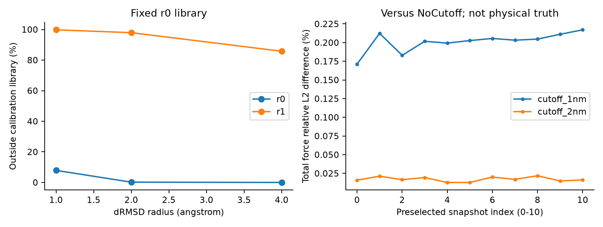

# C：MD科学资格、输入来源与截断敏感性

2026-10-25 JST。`MEASURED`：本机OpenMM CPU同坐标能量/力；`DERIVED`：结构与参数审计；`UNVERIFIED`：准备历史、平衡资格和长时物理可靠性。正式MD配置未改。

## 输入身份不等于制备合格

[输入manifest](../../inputs/p1-fsd-ey/manifest.json)固定DeepDriveMD `b18dacba46f079644e4ee66191675375581955c3`的1FME folded/unfolded文件；folded-model1是参考NMR集合的第1模型。实际unfolded为28残基、504原子，其中253H；序列EQYTAKYKGRTFRNEKELRDFIEKFKGR，拓扑净电荷+4。文件与力场模板可匹配，并不能证明氢怎样添加、指定pH、热展开方法或初始平衡充分。

RCSB1FME为solution NMR、28残基、34个提交构象；其原始原子数与处理后504原子文件不同。原始结构论文Sarisky/Mayo2001可从作者学位论文所收录章节核查，其Fig2所述pH*5.0是NMR条件，不是当前MD质子化记录。此轮未找到unfolded处理脚本、质子化命令或独立平衡轨迹，均保持UNVERIFIED；不得据文件名补写“已热展开并平衡”。

每次现有MD重启做坐标reseeding、最小化、300K速度初始化，再运行2fs Langevin；不是checkpoint连续动力学恢复。原GBn2/Amber14/HBonds/CutoffNonPeriodic1nm来自固定上游实现。没有独立burn-in资格测试；温度平均接近300K、无崩溃、能量有限仅是基础数值检查。2.44ns为实际计算长度之和，不是连续、平衡、独立的轨迹总长；不可估计无偏转移率或声称验证折叠路径。

非周期距离不使用CRYST1最小镜像。S2实测4880/4880帧有盒/无盒接触图一致，不能写成数据已经污染；正式特征语义仍需明确批准。

## 非积分敏感性设计与数学口径

预先固定11构象：原unfolded，加r0/r1最长轨迹frame0/19/199/999/1999（0.5/10/100/500/1000ps）。三个系统独立构建、同504原子坐标/Amber14+GBn2/HBonds，仅cutoff为1nm、2nm或NoCutoff；同时检查NonbondedForce与CustomGBForce。OpenMM distribution 8.5.2（运行build串8.5.2.dev-36a30cb）CPU Threads=2。每系统每构象1次warm-up及3次技术重复，共132 getState（99计时重复），3个Context，0积分步；不最小化、不改坐标、不采样速度、不做constraint projection。

E_c(x)单位kJ/mol，F_c,i(x)单位kJ/(mol·nm)。能量代表值为3次计时重复的中位数；ΔE_c(x)=E_c(x)−E_NC(x)，相对构象差=[E_c(x)−E_c(x₀)]−[E_NC(x)−E_NC(x₀)]，x₀为unfolded。修正前误混用中位数与第1值，现从已有重复数据一致派生，初始差严格0；旧汇总保留及SHA见[修订](amendments.md)。

力比较两系统均取第1计时重复，保留原规则。δF_i=||F_c,i−F_NC,i||；报告504原子δF的median/p95/max和RMS=√(ΣδF_i²/504)，以及R_F=√(ΣδF_i²/Σ||F_NC,i||²)。分母零则NA，无人为epsilon。三技术重复的能量/逐原子力相对最大差另报，归一分母max(1相应单位,参考幅值)，>10⁻⁵记警告；R_F>0.10仅为强敏感性旗标，不是科学接受容限。

## 实测与未通过项

| 设置 | ΔE范围 kJ/mol | 相对初始构象ΔE范围 kJ/mol | R_F范围 | 重复性警告/11 |
|---|---|---|---|---:|
| 1nm vs NC | −1613.8122至−1610.5791 | −3.13466至0.09849 | 0.001711–0.002171 | 2 |
| 2nm vs NC | −808.8213至−807.7502 | −0.42394至0.64719 | 0.0001285–0.0002183 | 4 |
| NC自比较 | 0 | 0 | 0 | 6 |

全部能量/力有限，所有参数系统运行成功；但12/33方法×构象触发重复性警告，最大逐原子归一重复力差5.5240×10⁻⁵。**不称逐位确定或所有数值检验通过**。多线程归约/浮点效应是可能原因，未单独证实；没有改精度、筛掉警告或重跑挑更好结果。

图右横轴0为unfolded，1–5为r0五个时刻，6–10为r1。R_F图单位为百分比；原表是无量纲比例。截断引起的总力相对差约0.17–0.22%和0.013–0.022%，但总力中键合大项可稀释非键合变化。此次未分别测GB/普通非键力分项，不夸大“误差很小”意义。绝对势能偏移达上千kJ/mol，不能直接解释为结构物理误差：截断GB表达式含1/cutoff偏移，必须同时查看相对构象能量与力。

[系统参数](../执行证据/2026-10-24-s2-supplement/systems.json)及[序列化GB表达式](../执行证据/2026-10-24-s2-supplement/gb-parameter-expressions.json)显示两种截断下两非键力均method=1，cutoff分别1/2nm；NoCutoff两力method=0，序列化中残留默认cutoff=1不表示启用截断。介电常数solute1/solvent78.5、kappa0嵌入表达式而不是getGlobalParameter接口；GB表面项与参数原文已保留。

[完整33行敏感性](../执行证据/2026-10-24-s2-supplement/physics-sensitivity.json)、[132次逐请求能量/时间](../执行证据/2026-10-24-s2-supplement/physics-evaluations.json)、[manifest](../执行证据/2026-10-24-s2-supplement/physics-manifest.json)可复核所有构象、重复、单位和哈希。原逐原子力数组/系统XML保留本地。C整个进程2.0383s，系统/Context创建和setPositions另记；重复getState可能使用缓存，不能解释为MD步耗时或目标GPU成本。

## 一手来源及检索覆盖

| 来源 | 本次支持的事实 | 覆盖限制 |
|---|---|---|
| [RCSB 1FME](https://www.rcsb.org/structure/1FME) | NMR身份与结构集合 | 不证明处理后unfolded/H准备史 |
| [Sarisky博士论文所收录原文，PDF pp45–66 / Fig2 p64](https://thesis.library.caltech.edu/2148/1/sarisky_phd.pdf)；原文DOI10.1006/jmbi.2000.4345 | FSD设计与NMR背景，pH*5.0属于NMR条件 | 仅核查相关章节，非整本精读；不能迁移为MD pH |
| [DeepDriveMD固定科学函数](../../literature/p1-concrete-2026-10-19/source-snapshots/deepdrivemd/apps/openmm_simulation/app.py) | 实际Amber14/GBn2/1nm配置 | 上游可运行不等于本研究科学合格 |
| [OpenMM8.5.2固定指南：Implicit Solvent](https://github.com/openmm/openmm/blob/8.5.2/docs-source/usersguide/application/02_running_sims.rst#L620-L645) | 支持NoCutoff与非周期截断，通常建议较大隐式溶剂截断，2nm为一般建议 | 不保证1FME2nm已合格；未用当前latest冒充8.5.2 |
| [OpenMM8.5.2 LangevinMiddleIntegrator.h](https://github.com/openmm/openmm/blob/8.5.2/openmmapi/include/openmm/LangevinMiddleIntegrator.h#L93-L103) | 相同seed不保证完全相同轨迹；当前LangevinIntegrator为其子类 | 不证明采样独立或平衡 |
| [Nguyen/Roe/Simmerling2013 GBn2论文](https://pmc.ncbi.nlm.nih.gov/articles/PMC4361090/) | 原始GBn2参考入口 | 网页正文受访问限制，仅摘要/索引核查，不声称完整精读或据此认证容差 |

## 就绪判断

**NOT READY 认证正式MD科学协议。** 本次只量化有限同坐标截断敏感性，NoCutoff也只是同一近似力场内比较基准，不是真实物理真值。缺少准备史、质子化/pH、独立平衡/采样资格、领域容差及长时影响验证。建议先与领域导师确认可用起始准备协议和评价目标；若更改cutoff/burn-in/输入，必须重新做最小资格及成本校准，不能沿用旧1nm成本直接比较后续策略。本次没有自行改正式配置或运行新轨迹。
